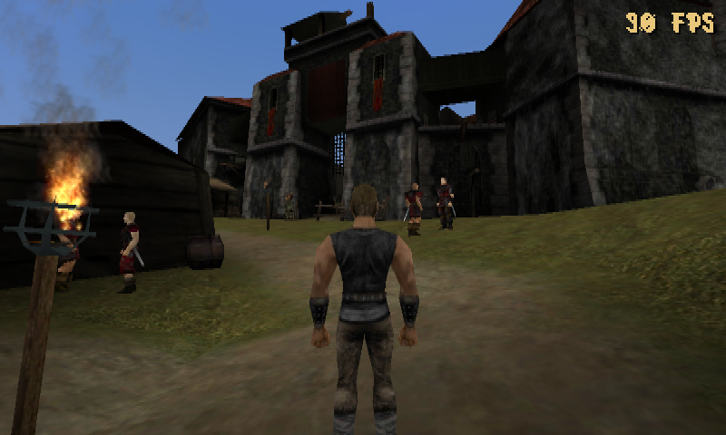

# Gothic 3DS — Gothic 1 on the New Nintendo 3DS

> **Game data is not distributed.** This project contains nothing from Gothic: you need your own legal copy, and the baked `data.pak`, `music.pak`, `speech.pak` and the music WAVs you produce from it must not be published.

A port of **Gothic 1** to the **New Nintendo 3DS** on a custom engine (C++17, its own renderer for the PICA200 GPU, its own Daedalus virtual machine). The game takes your original files, bakes them into a compact `data.pak` and runs the world on the console: scripts, dialogue, combat, magic, townsfolk with daily routines, sound and voices.



## Features

**World**
- Real Gothic 1 worlds (and Gothic 2 mods such as Chronicles of Myrtana: Archolos via `--mod`; Archolos is still being verified).
- The world is cut into 40 m chunks and streamed in the background within a memory budget; distant chunks are unloaded; culling by 10 m clusters. Draw distance up to 200 m, 60 fps in the castle.
- ETC1/ETC1A4 textures with mipmaps, quantised vertices, lightmaps, water, sky and time of day, portals between worlds and interiors.
- Lamps, campfires and torches with flames and particles; distant objects dissolve instead of popping in.
- **Graphics+** (menu: Graphics → Graphics+, everything off by default):
  - baked ambient occlusion in the vertices (`g3ds-bake --ao low|high`);
  - trees, bushes and grass swaying in the vertex shader (`--wind`);
  - round shadows under the hero and townsfolk;
  - **far layer** (`--far-lod`): a coarse, simplified copy of the whole world drawn beyond the draw distance (250 / 400 / 600 m) and over chunks that did not fit in memory. Only checked on PC so far; it costs about 1.5–2 MB of linear memory on the console.
  - Under load the foliage stops swaying and shadows stay on the hero alone before objects start to disappear.
- The world's memory budget on the 3DS adapts to the free linear memory (it used to be a hard 20 MB).

**Character and controls**
- Hero with skeletal animation from the game files: walking, running, swimming, ladders, jumping, climbing ledges, sneaking.
- Third-person camera using the original settings (`CAMERA.DAT`); two control schemes: console (after Gothic Classic on PS) and classic PC.
- Inventory, quick slots on the bottom screen, diary, character window, pause menu with settings (distance, object mode, frame rate, sound, language).
- Saving and loading of position and story, quick save.

**Combat and magic**
- Combat by the game's rules: target lock, combo strikes with direction, parry, dodge back, looting corpses.
- Bow and crossbow: aiming, arrows with gravity and a hit-throw, the white trail as in the original.
- Magic driven by the game's scripts: fire bolt, fireball, lightning, healing, scrolls and runes, effects from `VISUALFX.DAT`; instant spells fire at once, chargeable ones charge; area spells (fire rain).

**Townsfolk and scripts**
- Own Daedalus virtual machine: 2075 of 2075 runs matched the ZenKit interpreter.
- More than a thousand characters are placed by the startup scripts; the nearest live by a daily routine: they walk the waypoint network, stand guard, sit at campfires and on benches, work at the anvil, sleep in beds.
- Perception and reactions to the hero: sight, hearing, threats, attacks, creatures and humans.
- Dialogue with the real lines, quests and chapters, items in hand and in the world, chests, searching.
- **Teachers and learning points:** the scripts' own teaching (points paid, attributes raised, talents set via `Npc_SetTalentSkill`) works; sneaking and the circles of runes need the learnt skill, as in the original; the character page lists the talents.
- **Barter:** a character whose dialogue has a trade entry (`C_INFO.TRADE`) opens his wares on the bottom screen; buy and sell for ore at the scripts' prices (the item's value, times `TRADE_VALUE_MULTIPLIER` when the scripts have it).
- Experimental compatibility mode for Ikarus-based mods: writes to constants are allowed and the Ikarus memory primitives return 0 (no emulation of Ikarus memory yet).

**Sound**
- Footsteps, combat and world sounds driven by animation events, music by zone, time of day and combat, voiced lines (`speech.pak`). Needs the DSP firmware, see below.

**Tools**
- `g3ds-bake` (Linux/WSL/Windows) and the **Gothic3DS-Baker.exe** window: one-click baking without WSL (`windows/README.md`).
- The `g3ds-host` host build: the same renderer on PC for debugging; `ctest` tests (6 suites), the console-code check `scripts/check_3ds.sh`.
- Interface in four languages.

**Not there yet:** some triggers and mechanisms (doors, lifts), summoning and transformations, weather. Details and measurements: [`docs/HANDOFF.md`](docs/HANDOFF.md), [`docs/ROADMAP.md`](docs/ROADMAP.md), [`docs/TECHNICAL.md`](docs/TECHNICAL.md). Next for Graphics+: sky with clouds, height fog, a smooth transition to the far layer and more (the plan is at the end of `docs/HANDOFF.md`).

**Status.** Much of this has been verified on a real New 3DS (60 fps, world, townsfolk, AI), but the latest rounds (combat, magic, climbing, Archolos memory, the far layer) have only been checked on PC and are waiting for a test on the console. The project licence has not been chosen yet; third-party code: [`third_party/README.md`](third_party/README.md).

## Quick start

1. Download every file from the release
2. Run Gothic3DS-Baker.exe and choose your original game folder(Gothic 1,2)
3. Check every box(It should be fine for original games)
4. Run Bake
5. Put all baked files and 3dsx and smdh files to your N3DS sd card(3ds/gothic3ds)
6. Run through Homebrew Launcher

---

> **Easier for baking only (no WSL):** download `Gothic3DS-Baker.exe`, `g3ds-bake.exe` and `dmrender.exe` from the Releases page into one folder and run the window. See [`windows/README.md`](windows/README.md).

**Legal note.** The game's data (textures, models, sounds, music, scripts) is not distributed with this project and must not be distributed by you either. You need your own legal copy of Gothic 1. The files you produce (`data.pak`, `music.pak`, `speech.pak`, rendered WAVs) contain the game's content: keep them for yourself and never publish them. Only the source code, the tools, the compiled `gothic3ds.3dsx` (it contains no game data) and these instructions may be shared.

What you get at the end (step 7 is optional if you download a ready `.3dsx`): an SD card with `gothic3ds.3dsx`, `data.pak` (worlds and sounds), `music.pak` (music) and `speech.pak` (voices), plus the DSP firmware file `dspfirm.cdc` that every sound needs (see the box below).

> **⚠ NO SOUND WITHOUT `dspfirm.cdc`.** The 3DS plays sound through its DSP chip, and the chip needs a firmware file that Nintendo's system keeps inside the console. Homebrew cannot use it until you dump it **once** into the SD card as `sdmc:/3ds/dspfirm.cdc` (the `3ds` folder itself, **not** `3ds/gothic3ds`). On the console: Homebrew Launcher → **DSP1** (also in the Homebrew App Store) → run it → it says the firmware was dumped. Check on the PC that `3ds/dspfirm.cdc` exists on the SD card. Without this file the game runs but is completely silent: no effects, no music, no voices, however correct your `.pak` files are. After you quit the game, `3ds/gothic3ds/sound.txt` shows it in its first line: `dsp: open` is good; `dsp: NOT open (ndspInit 0xD880A7FA ...)` means the file is missing.

All commands below go into an **Ubuntu (WSL)** terminal unless stated otherwise. You can copy a whole command and paste it with the right mouse button. Lines starting with `#` are comments; do not type them.

**The main WSL rule.** Windows drives live under `/mnt/` in WSL: drive `C:` is `/mnt/c`, and `C:\Program Files (x86)\Steam` is `"/mnt/c/Program Files (x86)/Steam"`. Backslashes `\` and drive letters (`C:`) do not work in WSL commands. Always put paths with spaces in quotes.

---

## Step 0. What you need

- Windows 10 (2004+) or Windows 11.
- Gothic 1 installed (Steam version); you need the path to its folder.
- A **New Nintendo 3DS** with Homebrew Launcher, and the DSP firmware dumped with **DSP1** to `sdmc:/3ds/dspfirm.cdc` (see the warning above; once per console).
- About 15 GB of free disk space and an internet connection.

## Step 1. Install WSL and Ubuntu (once)

1. Open **PowerShell as administrator** (Start → PowerShell → right click → "Run as administrator").
2. Type:
   ```
   wsl --install -d Ubuntu
   ```
3. Reboot if asked. After the reboot an Ubuntu window opens: choose a user name and a password (the password is not shown while you type; that is normal).
4. From now on open the terminal via Start → **Ubuntu** (or type `wsl` in PowerShell).

## Step 2. Build tools (once)

```
sudo apt update
sudo apt install -y build-essential cmake ninja-build git zip unzip python3 wget gpg
```

Check all four; each must print a version and not "command not found":
```
cmake --version
ninja --version
g++ --version
unzip -v | head -1
```
`cmake` must be 3.16 or newer, `g++` GCC 11 or newer (C++20 is required). **If `ninja` or `unzip` is missing, step 4 and step 3 will fail**: run the `apt install` line above again.

## Step 3. The project

Keep the project **inside WSL** (your home folder `~`), not on the `C:` drive: everything is several times slower under `/mnt/c`.

1. Download the **newest** `gothic3ds-base.zip` and keep exactly one copy of it in Windows, e.g. in `C:\Users\YOUR_USER\Downloads` (delete old copies: browsers add `(1)`, `(2)` ... to the names and an old one is easy to unpack by mistake).
2. Find it and check that it is the right one (replace `YOUR_USER` with your Windows user name, the folder name under `C:\Users`):
   ```
   cd ~
   ZIP=$(ls -t /mnt/c/Users/YOUR_USER/Downloads/gothic3ds-base*.zip | head -1)
   echo "$ZIP"
   unzip -p "$ZIP" gothic3ds/tools/bake/import_zen.cpp | grep -c importZenSfxScript
   ```
   The last command must print `1` or more. If it prints `0`, this is an old archive: delete it and download the newest one.
3. Unpack it into the WSL home folder, **into an empty place** (move the old project away first, so old and new files do not mix):
   ```
   cd ~
   [ -d gothic3ds ] && mv gothic3ds gothic3ds_old_$(date +%s)
   unzip -q "$ZIP"
   cd ~/gothic3ds
   ls
   ```
   `ls` must show `CMakeLists.txt  Makefile  README.md  core  docs  engine  platform  scripts  tests  third_party  tools`.

Run all further commands from `~/gothic3ds`. If you closed the window, return with `cd ~/gothic3ds`.

> Files named `*:Zone.Identifier` are harmless Windows marks. To delete them: `find ~/gothic3ds -name '*:Zone.Identifier' -delete`.

## Step 4. Build the PC tools

```
cd ~/gothic3ds
cmake -S . -B build -G Ninja
cmake --build build -j
strings build/g3ds-bake | grep -c "script/sfx"
```

The last line must print a number above 0: it proves that the converter you built is the new one. (If `ninja` is not installed, cmake stops at once with "unable to find a build program corresponding to Ninja": install it with `sudo apt install -y ninja-build`, delete the folder `build` and run the commands again.)

The first run downloads the ZenKit library from GitHub and takes a few minutes. You get `build/g3ds-bake` (the converter) and `build/g3ds-host` (the PC runner).

Quick check without the game (optional):

```
./build/g3ds-bake synth -o /tmp/test.pak
ls -la /tmp/test.pak
```

Tests (optional, slow): `ctest --test-dir build --output-on-failure`.

## Step 5. The game's music as WAV

The original Gothic music is in the DirectMusic format, which the 3DS cannot play. So it is rendered once to WAV by a separate program, `dmrender`.

1. Build it (the dmusic library is downloaded automatically):
   ```
   cd ~/gothic3ds
   cmake -S tools/dmrender -B build-dmrender
   cmake --build build-dmrender
   ls build-dmrender/dmrender
   ```
   The last command must simply print the file's path.
2. Render all the music (the folder is the game's `_work\DATA\Music`; the program searches the subfolders `orchestra`, `dungeon`, `menu_men` ... by itself):
   ```
   build-dmrender/dmrender "/mnt/c/Program Files (x86)/Steam/steamapps/common/Gothic/_work/DATA/Music" ~/music_wavs
   ```
   To try one theme, add its name at the end: `... ~/music_wavs OC_DAY_STD.sgt`. The result is `~/music_wavs/*.wav`.
   **Music inside archives (Gothic 2, Chronicles of Myrtana).** The `.sty` styles and `.dls` sound banks are often inside the game's `.vdf`/`.mod` archives, not loose in `_work/Data/Music`; then `dmrender` prints `cannot load` for many themes. Extract everything it needs into one folder first and render from there:
   ```
   ./build/g3ds-bake extract --game "/mnt/c/Program Files (x86)/Steam/steamapps/common/TheChroniclesOfMyrtana" -o ~/music_src
   build-dmrender/dmrender ~/music_src ~/music_wavs
   ```
   (The `.mod` archives in `Data/`, such as `KM_Music.mod`, are included automatically.)
3. The render is exactly one cycle of the theme: the ring-out of the last notes is mixed into its beginning, so that the theme loops without a gap (`--no-fold` keeps the old tail at the end; WAVs rendered with an older `dmrender` have a short silence at every loop: render them again).
4. Listen to a file or two in Windows: `\\wsl$\Ubuntu\home\YOUR_NAME\music_wavs`.

If the program prints `cannot load` for a theme, its `.sty` or `.dls` was not found; other themes are not affected.

## Step 6. Bake the game's data (`data.pak`, `music.pak`, `speech.pak`)

The converter reads the game's files and makes an archive for the 3DS. The game itself is not touched.

```
cd ~/gothic3ds
mkdir -p ~/out
./build/g3ds-bake world --game "/mnt/c/Program Files (x86)/Steam/steamapps/common/Gothic" -o ~/out/data.pak --music-dir ~/music_wavs
```

Good to know:
- The converter runs for several minutes and prints a report. It should contain lines like `script/sfx: SFX.DAT`, `sounds: N C_SFX instances ... M baked` (M must be well above zero), `ambient sounds: ...`, `script/music: MUSIC.DAT` and `music: N C_MUSICTHEME instances ... K baked` (K above zero). If a number is 0: the game's sounds and themes live in `SFX.DAT` and `MUSIC.DAT` in `_work\Data\Scripts\_compiled`; the report says `sounds: SFX.DAT not found` / `music: MUSIC.DAT not found` if they are missing. If there is no `music:` line at all, check that `--music-dir` points to the folder with the WAVs from step 5. Check quickly: `grep -E "script/(sfx|music)|sounds:|music:" ~/out/bake.log`.
- `music.pak` and `speech.pak` appear next to `data.pak`: all three are needed (`speech.pak` holds the spoken lines; without it the game shows subtitles only).
- The voices come from the game's own `Speech.vdf`/`Sounds.vdf` (or loose files in `_work\Data\Sound\Speech`). The report has a line `voices: N lines of dialogue, M recordings baked (... MB ...)`; M should be in the thousands. The voices are baked in **full quality** (16-bit, the recordings' own sample rate): `speech.pak` is large, probably 1–2 GB, and the converter needs that much free RAM while it works. That is fine for a 64–128 GB card. Smaller and lower quality, if you ever need it: `--voice-codec ima` (a quarter of the size) and/or `--voice-rate 11025`; skip the voices altogether: `--no-voices`. If M is 0 the game was installed without the speech archive (some localized versions keep it elsewhere) — send the `voices:` line to the developer.
- Print the report again with `./build/g3ds-bake info ~/out/data.pak`.
- The quality of the sound effects is set with `--sound-rate 22050`, of the music with `--music-rate 44100`, of the voices with `--voice-rate` (default: as recorded) and `--voice-codec pcm|ima`.
- **Graphics+** (optional): `--ao low` (or `high`) bakes shaded corners into the vertices, `--wind` lets trees, bushes and grass sway. `--far-lod` adds a coarse far layer drawn beyond the draw distance (tuning: `--far-cell M`, `--far-tris N` in thousands, default 80; about 1.5–2 MB on the console). All three are switched on in the game's menu (Graphics → Graphics+); without them in `data.pak` those menu items do nothing. Cost: about 10 % more vertices (memory) for `--ao`/`--wind` and some seconds to a minute of baking. The report says `ambient occlusion (--ao low): ...` and `plants that sway (kept with --wind): N trees, M bushes, K grasses` with the names it took for plants — send those lines if trees do not sway. More tree words for a mod: `--plant-words WORD1,WORD2`. `--vis` bakes a visibility table (what each map cell cannot see behind walls and hills); the menu item Graphics+ → Visibility uses it (off by default, untested on the console; baking takes minutes). `--lod` bakes simplified stand-ins for the world meshes of far chunks (Graphics+ → Far geometry, 40 m by default; the Windows baker has its own checkbox).
- **Never put the game's data into the project archive** and never publish `data.pak`, `music.pak` or `speech.pak`: they are the game's content.
- After every project update, bake `data.pak` again (`docs/HANDOFF.md` says in the section of the round whether that is needed).

See the result on the PC without a console (optional):
```
./build/g3ds-host --pak ~/out/data.pak --still --shots 1 --out ~/out/world
```

**Mods for Gothic 2 (Chronicles of Myrtana: Archolos).** Install the mod into your Gothic II folder as its installer says, then add `--mod` with the name of its `.ini` from the `System` folder:

```sh
./build/g3ds-bake world --game "/mnt/c/GOG Games/Gothic II" --mod Archolos -o ~/out/data.pak
```

The baker mounts the mod's `.mod` archives over the game, starts in the world the `.ini` names and uses the mod's own scripts. If it says it cannot tell the world, run it with `--zen NAME.ZEN` using one of the names it lists.

## Step 7. The 3DS program (`gothic3ds.3dsx`) — OPTIONAL

**You can skip this step.** The project's author publishes a ready-made `gothic3ds.3dsx`; it contains no game data (the data is in the separate `data.pak` and `music.pak` that you bake yourself in steps 4–6), so it may be shared freely. Download it and go straight to step 8. Build it yourself only if you want to change the code or do not trust a prebuilt file.

To build it you need the devkitPro toolkit.

1. Install its package manager (once):
   ```
   wget https://apt.devkitpro.org/install-devkitpro-pacman
   chmod +x install-devkitpro-pacman
   sudo ./install-devkitpro-pacman
   ```
2. Install the compiler and libraries for the 3DS (about 1 GB):
   ```
   sudo dkp-pacman -S 3ds-dev
   ```
   Press Enter at the questions (the default is "all").
3. Environment variables (add them to `~/.bashrc` so you need not type them every time):
   ```
   echo 'export DEVKITPRO=/opt/devkitpro' >> ~/.bashrc
   echo 'export DEVKITARM=/opt/devkitpro/devkitARM' >> ~/.bashrc
   source ~/.bashrc
   ```
4. Build:
   ```
   cd ~/gothic3ds
   make
   ```
   `gothic3ds.3dsx` and `gothic3ds.smdh` appear in the project root. After changing sources, repeat `make`; a clean rebuild is `make clean && make`.

## Step 8. Copy to the SD card

Put the SD card into a card reader (it shows up in Windows as a drive, e.g. `E:`). First copy the result from WSL into Windows:

```
mkdir -p /mnt/c/gothic3ds_sd/3ds/gothic3ds
cp ~/gothic3ds/gothic3ds.3dsx ~/gothic3ds/gothic3ds.smdh ~/out/data.pak /mnt/c/gothic3ds_sd/3ds/gothic3ds/
cp ~/out/music.pak ~/out/speech.pak /mnt/c/gothic3ds_sd/3ds/gothic3ds/
```

Then, in Windows, copy the folder `C:\gothic3ds_sd\3ds\gothic3ds` to `3ds\gothic3ds` on the SD card. The card then holds:

```
/3ds/gothic3ds/gothic3ds.3dsx
/3ds/gothic3ds/gothic3ds.smdh
/3ds/gothic3ds/data.pak
/3ds/gothic3ds/music.pak
/3ds/gothic3ds/speech.pak
/3ds/dspfirm.cdc          <- NOT inside gothic3ds: directly in the 3ds folder
```

**Do not forget `/3ds/dspfirm.cdc`** (the box at the top): the DSP firmware dumped with DSP1 on your console. Without it there is no sound at all. Sound menu in the game: **Volume** (effects), **Music**, **Voices**.

Start: Homebrew Launcher → Gothic 3DS.

If something is wrong with the sound, after you quit the game the report `/3ds/gothic3ds/sound.txt` appears: it lists the sounds and themes the game looked for and did not find. Send it to the developer.

---

## Troubleshooting

| What you see | Cause and fix |
|---|---|
| `unable to find a build program corresponding to "Ninja"` / `CMAKE_CXX_COMPILER not set` | `ninja` (or the compiler) is not installed: `sudo apt install -y ninja-build build-essential cmake`, then `rm -rf build` and repeat step 4 |
| `unzip: command not found` | `sudo apt install -y unzip` |
| `strings build/g3ds-bake \| grep -c "script/sfx"` prints 0, or the report says `0 C_SFX instances` | An old converter/archive: the project folder holds old files. Repeat step 3 with the newest archive (check it with the `unzip -p ... \| grep -c importZenSfxScript` command), then `rm -rf build` and step 4 |
| `cannot find or open .../YOUR_USER/Downloads/...zip` | `YOUR_USER` must be replaced by your real Windows user name; list them with `ls /mnt/c/Users` |
| `cmake: command not found` | Step 2 was not done: `sudo apt install -y build-essential cmake ninja-build git` |
| `The source directory ".../tools/dmrender" does not exist` | You are not in the project folder (`cd ~/gothic3ds`) or it was unpacked elsewhere |
| `Parse error in command line argument: DMUSIC_DIR` | The command was cut off: a path must follow `-DDMUSIC_DIR=`. Step 5 does not need this option at all |
| `tools/dmrender` contains many extra files (`src`, `include`, `vendor`) | The dmusic library got copied into that folder. It must hold only `CMakeLists.txt` and `dmrender.c`; unpack the project again |
| `build-dmrender/dmrender: No such file or directory` | The build did not finish: run `cmake --build build-dmrender` and read the last lines with `error` |
| `usage: dmrender MUSIC_DIR OUT_DIR ...` | Both paths are needed: where the music is and where to put the WAVs |
| `No such file or directory` for the game path | Wrong path: check with `ls "/mnt/c/Program Files (x86)/Steam/steamapps/common/Gothic"`; drive letters like `C:` and `\` do not work |
| `Please set DEVKITARM in your environment` | Item 3 of step 7 was not done; run `source ~/.bashrc` |
| The converter cannot open / find `WORLD.ZEN` | That is not the game folder. It must contain `Data` and `_work` |
| The game is silent on the 3DS (no effects, no music, no voices) | `/3ds/dspfirm.cdc` is missing on the SD card: run DSP1 on the console. `sound.txt` then starts with `dsp: NOT open (ndspInit 0xD880A7FA ...)` |
| Sound and music work, nobody speaks | `speech.pak` is not next to `data.pak`, the **Voices** slider is 0, or the bake had no recordings (`voices:` line of the report, `voices:` line of `sound.txt`) |
| Sound works, no music | `music.pak` is not next to `data.pak`, or the theme names were not found in `sound.txt`; send the report |
| `wsl: ... localhost proxy ...` warning | Harmless for the build |
| Very slow | The project is on `/mnt/c`. Move it to `~` (step 3) |

## Updating the project

When a new `gothic3ds-base.zip` arrives: repeat step 3 (find and check the newest archive, move the old project away, unpack), then steps 4, 6, 7 and 8. The project is rebuilt from scratch (a few minutes). The WAV files in `~/music_wavs` and the results in `~/out` are outside the project and stay, so step 5 is needed only if you want to render the music again.

