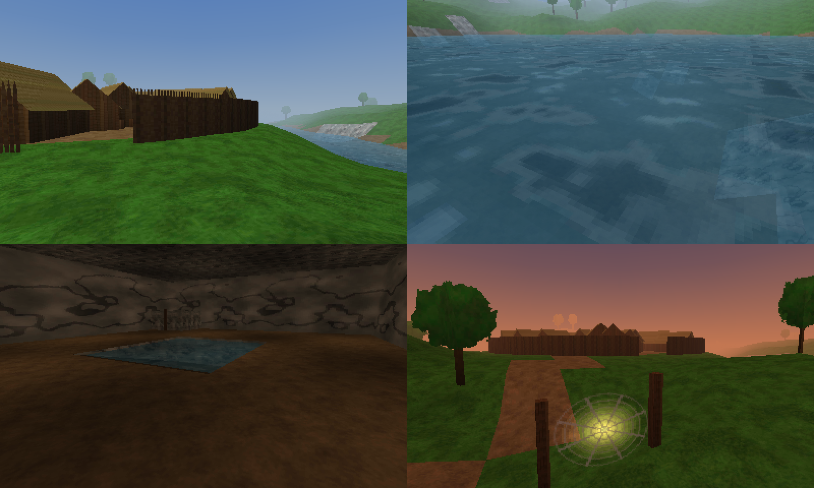
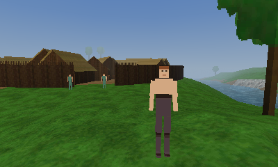
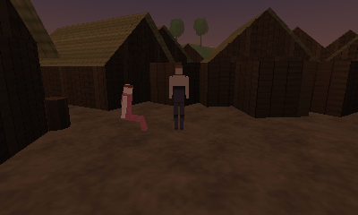
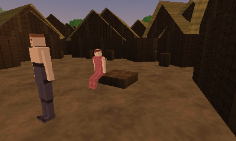
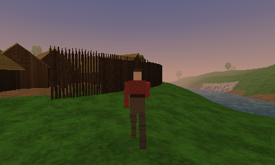
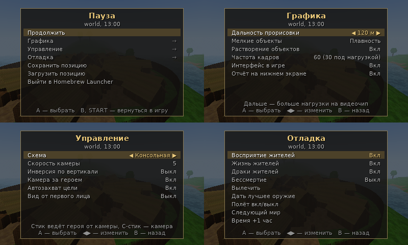
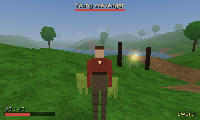

# Gothic 3DS — база порта

> **Данные игры не распространяются / Game data is not distributed.** Проект не содержит ничего из Gothic и не должен: нужна легальная копия игры, а `data.pak`, `music.pak`, `speech.pak` и WAV с музыкой, которые вы запекаете из неё, нельзя публиковать. This project contains nothing from Gothic; you need your own legal copy, and the `data.pak`, `music.pak`, `speech.pak` and music WAVs you bake from it must not be published.
>
> Инструкция по сборке с нуля (English first, then Russian): [`docs/BUILD_WSL.md`](docs/BUILD_WSL.md). / Step-by-step build guide for Windows + WSL: [`docs/BUILD_WSL.md`](docs/BUILD_WSL.md).


Основа для запуска мира Gothic 1 на New Nintendo 3DS: конвертер ресурсов на ПК, формат данных под PICA200 и рантайм, в котором по мирам игры можно ходить, плавать и переходить из одного в другой. Это этапы 0–2 плана и начало этапов 3 и 4: у игрока есть персонаж — скелетная модель героя с анимациями из файлов игры, управление и камера по схеме оригинала, — а мир населён и живёт: скрипты самой игры исполняются своей виртуальной машиной Daedalus, расставляют персонажей и существ по местам их распорядка дня и ведут их через день — жители ходят по сети путей, встают на посты, садятся у костра и на скамьи, работают у наковальни, ложатся в кровати. Звук (шаги, бой, звуки мира) и музыка есть (см. «Звук и музыка» ниже).

Данные игры в репозиторий не входят и не распространяются: конвертер читает вашу установленную копию.

Текущее состояние, замеры на консоли, открытые ошибки и ближайшие задачи — в [docs/HANDOFF.md](docs/HANDOFF.md).



## Что внутри

| Часть | Каталог | Назначение |
|---|---|---|
| Конвертер `g3ds-bake` | `tools/` | Читает миры, лайтмапы, объекты (меши, модели, декали), порталы, текстуры, скелет, тело, голову и анимации героя из VDF, настройки камеры и скрипты игры (`GOTHIC.DAT`) через ZenKit; исполняет стартовые скрипты, чтобы узнать, кто живёт в мирах, и запекает их модели; пишет `data.pak` |
| Ядро | `core/` | Форматы архива, текстур и чанков мира; общие для ПК и консоли |
| Движок | `engine/` | Фоновая подгрузка чанков, отсечение, регулятор нагрузки, столкновения, ходьба, плавание, лестницы, вода, небо и время суток, переходы между мирами; скелетные модели и анимация с движением от корневой кости, герой, камера от третьего лица; виртуальная машина Daedalus (`script.*`), слой игры — что скрипты делают с миром (`game.*`), жители мира (`npcs.*`), их жизнь — состояния, очередь действий, ходьба, пользование предметами (`npc_ai.cpp`), сеть путей (`waynet.*`), предметы мира (`mobs.*`) |
| Бэкенд 3DS | `platform/3ds/` | libctru + citro3d, вершинный шейдер PICA |
| Бэкенд ПК `g3ds-host` | `platform/host/` | Программный рендер 400×240 с тем же конвейером, для отладки без консоли |
| Тесты | `tests/` | Модульные и сквозные, включая импорт из форматов ZenGin, проверку бэкенда 3DS на имитации citro3d, исполнение собранного шейдера PICA на ПК и сверку виртуальной машины с интерпретатором ZenKit |

Рантайм (`core`, `engine`, `platform`) написан на C++17 без STL, исключений и RTTI. Инструменты — C++20, этого требует ZenKit.

## Сборка на ПК

Пошаговая инструкция «с нуля» для Windows через WSL (WSL, сборка, запекание, музыка, 3DS, SD-карта): [`docs/BUILD_WSL.md`](docs/BUILD_WSL.md).

Нужны CMake 3.16+, компилятор с C++20 и git. ZenKit скачивается при настройке.

```sh
cmake -S . -B build
cmake --build build -j
ctest --test-dir build --output-on-failure
```

**Всё одной командой:** `scripts/build_all.sh` — сборка для ПК, запекание `data.pak` (и музыка/голоса) и сборка `.3dsx` идут параллельно, затем всё копируется в папку SD. Настройки (папка игры, `~/out`, музыка, SD) — в `scripts/build.conf` (образец: `scripts/build.conf.example`). Запекание пропускается, если код пекаря и параметры не менялись (`--force` — всё равно запечь). Ключи: `--no-bake`, `--no-3ds`, `--no-check` (запекание без сверки скриптов, на минуты быстрее), `--test`, `--no-copy`, `--synth` (тестовая сцена без игры). Логи — `~/out/logs/`.

Проверка всей цепочки на встроенной тестовой сцене, игра не нужна:

```sh
./build/g3ds-bake synth -o data.pak
./build/g3ds-host --pak data.pak --frames 300 --shots 4 --out frame
```

`g3ds-host` пролетает камерой по миру, сохраняет кадры в PNG и печатает статистику: треугольники и вызовы отрисовки на кадр, занятую память, перерисовку. Тестовая сцена состоит из двух миров: долины с лагерем и пещеры, куда ведут ворота рядом со стартом (`--world cave` открывает пещеру сразу). В ней есть и тестовый персонаж из коробок с тем же набором анимаций и переходов, что нужен герою: `--walk` показывает его со спины. Сцена населена: у неё есть свой скрипт на Daedalus (`tools/bake/synth_script.cpp`), написанный так, как написаны скрипты Gothic — классы `C_NPC` и `C_ITEM`, прототипы, распорядок дня через `TA_Min`, функции `STARTUP_WORLD` и `STARTUP_CAVE`. Его компилирует собственный небольшой компилятор проекта, а дальше он проходит тот же путь, что и скрипты игры. Состояния распорядка (`ZS_Guard`, `ZS_SitAround`, `ZS_Sleep`, планировщик существ `ZS_MM_AllScheduler`) написаны в нём так же, как в игре: функция начала, `_Loop` и `_End`, которые говорят движку `AI_GotoWP`, `AI_AlignToWP`, `AI_PlayAni`, `AI_Wait`. У ворот стоят два стражника, на дороге рудокоп, у леса бродят четвероногие существа; `--time 19.9 --to-time 20.4 --frames 900` показывает, как с наступлением вечера стражник уходит с поста через ворота к костру и садится.

## Запекание миров Gothic

```sh
./build/g3ds-bake world --game "/путь/к/Gothic" -o data.pak
./build/g3ds-bake info data.pak
./build/g3ds-host --pak data.pak --still --shots 1 --out world
```

Конвертер начинает с `WORLD.ZEN` и сам запекает миры, в которые из него ведут триггеры смены уровня (шахты, храм). Всё попадает в один `data.pak`, текстуры у миров общие.

### Моды Gothic 2 (Chronicles of Myrtana: Archolos и другие)

Мод ставится в папку Gothic 2 (Data/ModVDF/*.mod и System/<Мод>.ini). Запекание начинается с мира, который называет сам мод, а не с `NEWWORLD.ZEN`:

```sh
./build/g3ds-bake world --game "/путь/к/Gothic II" --mod Archolos -o data.pak
```

- `--mod ИМЯ|ФАЙЛ` — `.ini` мода: путь или имя файла в `System/` (регистр и `.ini` не важны). Из него берутся `[SETTINGS] World=` (стартовый мир), `[FILES] GAME=` (скрипты мода, `ARCHOLOS.DAT` вместо `GOTHIC.DAT`), `OUTPUTUNITS=` (диалоги) и `VDF=` (какие `.mod` подключать; если строки нет, как у CoM, подключаются все `.mod` из `Data/`).
- Архивы `.mod` монтируются поверх `.vdf` игры и **перекрывают** их файлы независимо от дат. Скрипты, камера и диалоги мода берутся из его архивов раньше, чем из лежащих рядом файлов игры.
- `--mod-archive ФАЙЛ|ИМЯ` (можно несколько раз) — подключить архив без `.ini`; `--mod-all` — подключить все `.mod`. Если мир не назван ни в `.ini`, ни через `--zen`, берётся единственный `.ZEN`, который принесли архивы мода; иначе конвертер перечисляет найденные `.ZEN` и просит указать нужный через `--zen`.
- Переходы между мирами работают как раньше: запекаются все миры мода, в которые ведут триггеры смены уровня.

В отчёте строки `mod: …` показывают, что подключено. Игра без `.ini` (Chronicles of Myrtana в Steam: `Data/KM_Worlds.mod`, `KM_Scripts.mod`, `KM_Music.mod` и т.д.) запекается и без `--mod`: все `.mod` из `Data/` подключаются сами, а если мир не назван, конвертер перечисляет найденные `.ZEN` (самые большие первыми) — выберите главный и передайте `--zen ИМЯ.ZEN`.

Проверялось только на искусственном моде в тестах (`test_zen`, раздел «mod over the game»), на настоящем Archolos — нет.

Что переносится из игры:

- меш мира со светом вершин и светом лайтмапов;
- объекты: меши `.3DS`, модели `.MDS`/`.ASC` в позе покоя (сундуки, кровати, двери), морф-меши `.MMS`, декали;
- вода: полупрозрачная, с анимацией кадров текстуры и прокруткой;
- триггеры смены уровня и точки прибытия, лестницы, признак подземного мира;
- герой: скелет `HUMANS.MDH`, тело `HUM_BODY_NAKED0.MDM`, голова `HUM_HEAD_PONY.MMB` с текстурами героя (тело 4, цвет кожи 1, лицо 9) и анимации из `HUMANS.MSB` — стойка, бег, шаг, шаг назад и вбок, поворот на месте, прыжок, падение, плавание, все переходные анимации между этими состояниями и времена смешивания (`aniBlend`);
- камера: настройки `CAMMODNORMAL`, `CAMMODSWIM` и `CAMMODFALL` из `_work/Data/Scripts/_compiled/CAMERA.DAT` — дальность, возвышение, наклон взгляда, инерция. Если файла нет, берутся настройки проекта.

Если файлов героя в игре не найдётся или их не удастся прочитать, миры запекаются как обычно, в отчёте будет причина, а игра останется с видом от первого лица.

Скрипты и жители мира:

- Скомпилированные скрипты игры `_work/Data/Scripts/_compiled/GOTHIC.DAT` перекладываются в образ для консоли (`script/gothic`): таблица символов с хешами имён вместо имён, переменные и строки в плоских таблицах, байткод без изменений.
- Конвертер сверяет свою виртуальную машину с эталонной — интерпретатором ZenKit, на котором играет OpenGothic. Обе исполняют на вашем `GOTHIC.DAT` одно и то же: создание героя, стартовые функции миров, каждый диалог (условие и содержание) и каждый предмет. Всё, что скрипты просят у движка, и каждый созданный объект сравниваются. Итог — строка `checked against the reference interpreter`. Сверка идёт в отдельном процессе: если эталонный интерпретатор упадёт или зависнет, в отчёте будет об этом строка, а запекание продолжится.
- Затем конвертер сам исполняет стартовые скрипты каждого мира (`STARTUP_<МИР>`, `INIT_<МИР>`) и смотрит, кого они поставили в мир: `Wld_InsertNpc` создаёт персонажа, код его экземпляра одевает его (`Mdl_SetVisual`, `Mdl_SetVisualBody`, доспех читается из предмета), `TA_Min` заполняет распорядок дня.
- Для каждого встреченного облика запекаются модели: скелет с анимацией стойки, тело или доспех с нужными вариантами текстур, голова. Одинаковые модели не повторяются.
- Именованные места мира — путевые точки и маркеры — запекаются таблицей (`world/<имя>/points`) и опускаются на землю: в файлах игры они висят примерно в метре над ней.
- Сеть путей мира (`world/<имя>/waynet`): путевые точки с именами, связи между ними и свободные точки (`FP_…`) — места, где жители сидят, стоят, работают.
- Предметы мира, которыми жители пользуются (`world/<имя>/mobs`): кровати, скамьи, наковальни, котлы — всё, что в игре называется «моб» (`oCMobInter` и производные, кроме лестниц). Для каждого записан вид («схема») — первое слово имени модели: `BEDHIGH_PSI.ASC` — это `BEDHIGH`, — число состояний и места, где встают, чтобы им пользоваться: узлы `ZS_POS…` из скелета модели, опущенные на пол мира.
- В образ скриптов добавляется таблица состояний: для каждой функции, у которой есть пара `…_LOOP` или `…_END`, — все три. Движок оригинала находит их по имени, а имён в образе нет.
- Скелеты жителей получают анимации стойки и ходьбы и те анимации, которые называют скрипты: конвертер собирает из текстов скриптов все имена вида `T_…`, `S_…`, `R_…`, добавляет к ним вставание из каждой позы (`T_SIT_2_STAND` скрипты не называют, его выводит движок) и берёт из них те, что есть в скрипте модели.
- Анимации пользования предметами скрипты тоже не называют: они называют вид предмета (`AI_UseMob(self, "BENCH", 1)`), а имена движок складывает сам — `T_BENCH_STAND_2_S0`, `T_BENCH_S0_2_S1`, `S_BENCH_S1`. Поэтому для каждого вида, который есть и в мирах, и в текстах скриптов, скелет получает все анимации, чьи имена начинаются с `T_<ВИД>_` и `S_<ВИД>_`.
- Конвертер просматривает код состояний и пишет, какие функции движка они вызывают и каких из них проект ещё не выполняет (строки `life:`). Сами состояния он не исполняет: это происходит только в игре.

Без `GOTHIC.DAT` миры запекаются как раньше, пустыми, и отчёт это говорит. `--no-scripts` отключает всю эту часть.

Частицы (костры, факелы) и спрайты, повёрнутые к камере, пока пропускаются; конвертер пишет их число. Двери и ворота рисуются, но не мешают пройти: открывать их ещё нечем.

Чанк мира — квадрат 40×40 м — режется ещё и на клетки по 10 м («кластеры»): у каждого материала в каждой клетке свой отрезок индексов. Игра рисует из чанка только клетки, которые попали в кадр и лежат ближе конца тумана; отрезки одного материала идут в буфере подряд, так что соседние видимые клетки уходят одним вызовом отрисовки. Вершины при этом не дублируются, архив не растёт.

Полезные параметры: `--zen OLDMINE.ZEN` (начать с другого мира; можно указать несколько), `--no-follow` (не запекать миры за порталами), `--chunk 4000` (размер чанка в см), `--cluster 1000` (размер клетки внутри чанка в см; 0 — не резать), `--max-tex 128` (длинная сторона текстуры), `--quality 0|1|2` (качество ETC1), `--no-objects` (только ландшафт), `--no-lightmaps` (не запекать свет помещений), `--flip` (перевернуть порядок обхода вершин), `--seal 0.5` (на каком расстоянии в см заделывать швы между полигонами), `--no-seal` (не заделывать), `--step 0.125` (шаг координат вершин в см), `--no-hero` (не запекать героя), `--no-scripts` (не запекать скрипты и жителей), `--hero-script`, `--hero-body`, `--hero-head`, `--hero-skin 4,1,9` (другой скрипт модели, тело, голова и варианты текстур: тело, цвет кожи, лицо).

В конце `g3ds-host` печатает строки `scripts` (размер образа, число исполненных инструкций, жалобы), `inhabitants` (сколько персонажей создали скрипты, сколько из них в этом мире, сколько было рядом и на экране, сколько моделей прочитано) и `life` (сколько жителей жили и шли одновременно, сколько вызвано функций состояний и выполнено действий, найдено путей, прочитано анимаций, сколько раз кто-то воспользовался предметом). Строка `update` раскладывает время шага игры по частям — подгрузка чанков, жители (и отдельно скрипты), персонаж игрока, камера — и считает запросы столкновений; строка `triangles/frame` показывает, сколько треугольников нарисовано из тех, что есть в видимых чанках. `--who` добавляет список ближних жителей: кто что делает и где (у занятого предметом — вид предмета), в каком состоянии и сколько секунд, стадия и состояние предмета, что скрипты знают о теле и имя анимации. `--slope-probe X,Y,Z` ставит героя в место с координатами из строки `pos` консоли, даёт постоять 5 с, затем 8 раз разбегается и прыгает (через каждые 45°) и печатает по кадрам, что делает контроллер: положение, на земле ли, состояние тела, скольжение, нормаль пола, скорости; в конце — сколько попыток застряли и сколько раз сработала защита (выход из скалы, «поставлен на пол»). Столбцы те же, что в `slope.txt` с консоли (L+R+SELECT), так что запись с консоли и пробу можно положить рядом. `--probe-fps 60` — шаг как на консоли (по умолчанию 30); `--probe-grid M` — то же из каждой точки сетки через метр в пределах M метров вокруг (печатаются полностью только попытки, где герой застрял или сработала защита). `--whole-chunks` рисует чанки целиком, как до кластеров, — для сравнения. `--to-time H` ведёт часы от `--time` до H за время прогона — так видно, как сменяется распорядок; `--standing` отключает жизнь жителей (они только стоят по местам).

У `g3ds-host` три режима: пролёт над миром (по умолчанию), `--walk` (ходьба по земле со столкновениями; если в архиве есть герой — с видом от третьего лица, `--first-person` возвращает вид из глаз) и `--still` (неподвижный вид). `--world oldmine` выбирает мир, `--cam X,Y,Z,YAW,PITCH` — точку и направление взгляда, `--time 19.5` — время суток, `--detail 7000,3500` — дальность прорисовки средних и мелких объектов, `--stream sync|inline|thread` — как подгружаются чанки на ходу (`thread` — фоновым потоком, как на консоли).

Место с консоли можно открыть на ПК: строка `pos` на нижнем экране даёт координаты, например `--cam -1619,-1300,-4743,0,0 --still --shots 1`. Программный рендер закрашивает пиксели по тем же правилам, что и видеочип, поэтому щель в геометрии видна и в нём.

Конвертер проверяет себя и пишет результат в отчёт (`g3ds-bake info data.pak` печатает его снова):

| Строка отчёта | Что должно быть |
|---|---|
| `winding check` | больше 60% площади смотрит вверх; для подземного мира проверка ничего не говорит, и отчёт это отмечает |
| `lightmaps` | около 100% углов внутри прямоугольника лайтмапа |
| `objects` | `winding kept`, нет предупреждений о ненайденных файлах |
| `models` | расхождение позы покоя с позициями, записанными в меше, — сантиметры, а не метры (на настоящих данных ещё не сверялось) |
| `portals` | каждый портал ведёт в запечённый мир и нашёл точку прибытия |
| `seams` | сколько вершин сварено и сколько T-стыков закрыто; `+N triangles` — цена в треугольниках |
| `position step` | почти все чанки с шагом 0,125 см; чанки с более грубым шагом — гигантские треугольники моря и гор |
| `untextured` | материалы без текстуры или с ненайденной текстурой: имя материала, имя текстуры, число треугольников и цвет, которым они закрашены. Раньше такие полигоны рисовались фиолетовой шашкой |
| `character` | найдены скелет, тело и голова; поза покоя расходится с мешем на доли сантиметра; сколько вершин висит больше чем на двух костях (оставляются две сильнейшие) |
| `character mesh` | `winding kept`; `flipped` значит, что тело в файле вывернуто и конвертер это исправил |
| `character faces +Z` | куда героя несёт анимация бега. `turned by … degrees` значит, что модель смотрела в другую сторону и была развёрнута |
| `animations: rotations read conjugated` | повороты в анимациях ZenGin записаны «в обратную сторону»; конвертер сверяет оба прочтения с позой покоя. Первое число (градусы до позы покоя) должно быть намного меньше второго |
| `animations: hips … cm` | высота таза в позе покоя и в первой анимации — близкие числа (около 90 см) |
| `animations not found` | каких анимаций из списка нет; герой обходится более простыми |
| `skeleton`, `size`, `clips` | итог по модели: кости, треугольники, вызовы отрисовки, рост, список анимаций с длительностью и скоростью; `up N cm` у анимации значит, что она сама поднимает тело (разбег прыжка) |
| `blends` | переходы, которые в скрипте модели заданы не анимацией, а временем смешивания |
| `camera` | `from the game's CAMERA.DAT` и числа из него; иначе причина, по которой взяты настройки проекта |
| `models read from files of another name` | модели объектов, собранные не из файлов со своим именем: какой меш и какой скелет взяты и что об этом говорит скрипт модели. Объект, названный в мире как `.ASC`, — это один файл `.MDL` с его именем, и только если его нет — `.MDM` + `.MDH`; объект, названный как `.MDS`, собирается по скрипту модели. Скрипт может взять скелет из чужого файла и запретить его меш (`DONT_USE_MESH`); тогда берутся файлы с именем самой модели или зарегистрированный меш, а чужой меш — только если больше ничего нет |
| `fire places` | костры, жаровни и светильники (`oCMobFire`): для каждого вида — сколько их, какой эффект огня задан в мире и из чего собрана модель (файлы, части, текстуры). Пламя пока не рисуется |
| `other objects named like lights` | остальные объекты, в имени которых есть «лампа», «факел», «огонь», «свет»: сколько их и нарисованы ли |
| `places` | сколько именованных мест в мире и на сколько сантиметров в среднем они опущены на землю |
| `scripts: GOTHIC.DAT: …` | размер скриптов: символы, функции, экземпляры, внешние функции движка, размер образа. `names share a hash` — имена, которые не найти по имени (скриптам это не мешает: они обращаются по номеру) |
| `checked against the reference interpreter` | `N runs … N the same … 0 different`, `variables at the end the same`. `different` больше нуля — моя машина исполнила скрипт иначе, чем эталонная; ниже будут первые расхождения, пришлите их. `the reference objected to` — запуски, где эталонная машина сама сообщила об ошибке; они не сравниваются |
| `the player's character` | облик героя по скриптам: тело, варианты текстур, голова |
| `world '…': STARTUP_… puts N characters into it` | сколько персонажей поставили скрипты, у скольких есть распорядок дня, сколько предметов. `stand at places the world does not have` — места из скриптов, которых нет в мире; такие персонажи не рисуются |
| `start-up ran … instructions` | `0 complaints, 0 calls given up`; иначе последняя жалоба машины. `uses of members of no object` — обращения к полям несуществующего объекта: скрипты самой игры делают это, ответом служит ноль, эталонная машина поступает так же. Строка `where:` перечисляет, в каких функциях |
| `engine functions the start-up called that do nothing yet` | функции движка, которые скрипты вызвали, а проект ещё не реализует: имя и число вызовов. Это не ошибка, а список того, что впереди |
| `inhabitants` | сколько персонажей и обликов, для скольких есть модели, сколько запечено скелетов, тел, голов, треугольников и текстур; сколько мегабайт занимают модели, анимации и текстуры жителей |
| `animations: the scripts name or imply N` | сколько имён анимаций нашлось в скриптах, сколько к ним добавилось семейств анимаций пользования предметами и сколько анимаций получил каждый скелет |
| `way net` | точки сети путей, связи, километры путей, точки без связей, свободные точки |
| `clusters` | на сколько клеток по 10 м разрезаны чанки, сколько в клетке в среднем треугольников и отрезков. `needed bigger boxes` — чанки, где клеток вышло бы больше 255 и они взяты крупнее |
| `things to use: N of K kinds` | предметы мира по видам и сколько у них мест, где встают. `have none` — предметы без таких мест (модель без узлов `ZS_POS`): ими никто не пользуется, как и в игре |
| `things to use: the worlds have N kinds; the scripts name M` | какие виды предметов называют скрипты (для них запекаются анимации) и какие нет. Если вид, которым жители в игре явно пользуются, попал в `not named`, пришлите эту строку |
| `life: the scripts have N states; the people … are put into M` | сколько состояний в скриптах и в какие из них распорядки ставят жителей этих миров (по числу жителей) |
| `life: the states call N engine functions, K of which the engine carries out` | сколько функций движка вызывают состояния и сколько из них выполняется; остальные перечислены по числу состояний, которым они нужны. Это список ближайшей работы: чем выше функция в списке, тем больше жителей ведут себя без неё не так, как в игре |
| `kinds of trouble with the inhabitants' models` | облики, для которых модель не получилась, с причиной и примером персонажа |

## Сборка для 3DS

Нужен [devkitPro](https://devkitpro.org/wiki/Getting_Started) с группой пакетов `3ds-dev` (devkitARM, libctru, citro3d).

```sh
make
```

Получатся `gothic3ds.3dsx` и `gothic3ds.smdh`. На SD-карте:

```
/3ds/gothic3ds/gothic3ds.3dsx
/3ds/gothic3ds/gothic3ds.smdh
/3ds/gothic3ds/data.pak
```

Запуск через Homebrew Launcher. Управление по умолчанию — «консольное», по образцу Gothic Classic на консолях (стик ведёт героя туда, куда смотрит камера; камера своя, на C-Stick). В меню «Управление» можно вернуть классическую схему ПК-оригинала.

| Кнопка | Действие |
|---|---|
| Circle Pad | идти туда, куда наклонён, относительно камеры; слабый наклон — шаг. С захваченной целью — обход вокруг неё лицом к ней |
| C-Stick | вращать камеру вокруг героя; с захваченной целью — щелчок влево / вправо переводит захват на соседнего врага с той стороны |
| B | прыжок; на лестнице — отпустить её. Прыжок к стене до ~195 см высотой с площадкой наверху — герой хватается за уступ и забирается (не в воде и не с оружием в руках) |
| A | с пустыми руками перед вещью или сундуком (над ними метка «A …») — взять / открыть. Иначе удар; направление задаёт крестовина, удерживаемая при нажатии: влево — удар слева, вправо — справа, иначе прямой. Нажатие в окне удара продолжает комбо; подтверждение на экране смерти |
| Y (держать) | парирование |
| X | взять последнее оружие / убрать |
| ZL | ближнее оружие (если его нет — кулаки) |
| ZR | захват цели: ближайший враг перед героем / отпустить |
| Крестовина влево / вправо | с оружием в руке — направление удара (держать, нажимая A) |
| Крестовина вверх | с пустыми руками — кулаки (повторно — убрать) |
| Крестовина вниз | красться / идти обычно |
| L | быстрая магия (пока нет — подсказка) |
| R | быстрый доступ (пока нет — подсказка); в классической схеме — шаг вправо |
| SELECT | открыть / закрыть инвентарь (нижний экран). Пока он открыт, герой стоит: крестовина — выбор, L / R — страница, A — использовать, X — в быстрый слот (затем крестовина и A), B — закрыть |
| Касание нижнего экрана | десять быстрых слотов (касание — использовать), кнопки «Инвентарь», «Дневник», «Персонаж» |
| START | меню паузы |
| R + START / R + SELECT | быстрое сохранение / загрузка позиции |
| L + R + SELECT | записать последние 5 с движения героя в `SD:/3ds/gothic3ds/slope.txt` (дописывается в конец). Нажимать там, где герой застрял; в строке `pos` счётчик `sd` вырастет на 1 |
| START + SELECT (держать 1 с) | выход сразу (для отладки) |

Классическая схема: Circle Pad вверх — бег, вниз — отскок назад, влево / вправо — поворот; C-Stick поворачивает быстрее и наклоняет камеру; L / R — шаг в сторону; остальное как выше.

**Меню паузы** (START) рисуется на верхнем экране поверх остановленной игры: «Продолжить», «Графика», «Управление», «Отладка», «Сохранить позицию», «Загрузить позицию», «Выйти в Homebrew Launcher». Крестовина или стик — выбор, влево / вправо — изменить значение, A — выбрать, B — назад, START — в игру. Настройки сохраняются в `SD:/3ds/gothic3ds/settings.bin` сразу при изменении.

| Страница | Пункты |
|---|---|
| Графика | дальность прорисовки 40–200 м; мелкие объекты: «Плавность» (регулятор убирает их ради 60 к/с), «Баланс», «Устойчиво» (всё видно, при нехватке времени — 30 к/с); растворение объектов (после перезапуска); частота кадров: «60 (30 под нагрузкой)» или «ровно 30»; интерфейс в игре; нижний экран: «Инвентарь» или «Отчёт»; «Купол Барьера» (сияние на небе, гул — если он есть в SFX.DAT); «Игра» → «Течение времени» (стоит / сутки за 24 мин, 1 ч, 2 ч); «Интерфейс» → «Показывать FPS» (счётчик кадров сверху справа, для проверки) |
| Управление | схема (консольная / классическая); скорость камеры 1–10; инверсия по вертикали; камера сама заходит за спину на бегу; автозахват цели, когда взято оружие; вид от первого лица; оружие после зелья (снова в руки) |
| Отладка | восприятие жителей; жизнь жителей; драки жителей; бессмертие героя; вылечить; дать лучшее оружие из скриптов; дать набор предметов; полёт; следующий мир; время +1 час |

**Бой.** Герой берёт оружие в руки (анимация `T_1H_2_1HRUN` и т. п., руки меняются на середине), бьёт, парирует и отскакивает назад; у каждой атаки есть окна комбо из событий модели (`DEF_OPT_FRAME`, `DEF_HIT_END`, `DEF_WINDOW` в `.MDS`): нажатие в окне продолжает серию следующим ударом, нажатие мимо окна обрывает её. Удар попадает в кадр, который назначила анимация, по тому, кто перед героем в пределах дальности оружия. Урон считается по правилам Gothic: для каждого вида урона оружия — сила + урон оружия − защита цели, не меньше нуля; дальности берутся из `Gil_Values` скриптов. Человек, побитый не врагом, падает без сознания с 1 очком жизни и через время встаёт (`ZS_Unconscious`); враг и зверь — умирают (`ZS_Dead`). Спереди удар отбрасывает назад (`T_STUMBLEB`), сзади — вперёд (`T_STUMBLE`); удар, который ничего не пробил (доспех), не сбивает.

Жители дерутся по скриптам игры: состояния `ZS_Attack`, `ZS_MM_Attack` зовут `AI_Attack`, а движок выбирает ход по таблицам `FA_*` скриптов (`C_FightAI`): подойти, ударить, серия, удар сбоку, парировать, отскочить, обойти — по ситуации (враг замахивается, враг далеко, враг не в фокусе). Восприятия боя: `ASSESSDAMAGE`, `ASSESSFIGHTSOUND`, `ASSESSOTHERSDAMAGE`, `ASSESSDEFEAT`, `ASSESSMURDER`, `DRAWWEAPON`, `ASSESSREMOVEWEAPON`, `ASSESSTHREAT`, `ASSESSFIGHTER`, `ASSESSBODY`.

**Цель.** ZR захватывает ближайшего врага перед героем (сперва враждебных, до 15 м); захваченный подписан золотом сверху экрана, над ним — маркер. С захватом стик обходит вокруг цели, герой всегда к ней лицом. Со включённым «Автозахватом» цель захватывается сама, когда взято оружие. Без захвата сверху показывается тот, кто в фокусе.

**Интерфейс.** Внизу слева — здоровье героя, справа — что в руках; сверху — имя и здоровье цели; при смерти — «Вы погибли» и «A — загрузить позицию», без сознания — «Без сознания…». Шрифт — DejaVu Sans (лицензия Bitstream Vera), с кириллицей, двух размеров; атлас собирается скриптом `scripts/make_font.py` в `engine/ui_font.h`.

**Нижний экран** — в стиле консольной Gothic Classic. Пока ничего не открыто: сверху полоски здоровья и маны в рамках (на верхнем экране здоровья больше нет — только при «Нижний экран: Отчёт»), ниже **десять быстрых слотов** 1…0, как цифры на клавиатуре ПК (касание — использовать то, что в слоте: зелье выпивается, оружие берётся в руки, броня надевается — герой сам выбирает действие), и три кнопки: **Инвентарь**, **Дневник**, **Персонаж**. Открытая страница сверху показывает стрелку «◀» (закрыть) и своё имя; **пока страница открыта, герой стоит** — стик не ведёт, удары, парирование и оружие недоступны, а мир и враги продолжают действовать (как в оригинале: пользоваться инвентарём в бою можно, но это стоит времени).

- **Инвентарь:** сетка 5 в ряд, 4 ряда (прокрутка пальцем); вещи показаны **картинками своих 3D-моделей** — конвертер рисует каждую модель вещи в 48×48 (`icon/<визуал>`, длинные вещи лежат по диагонали, как в Gothic), со старым `data.pak` — нарисованные значки. Золотой уголок — надето, золотая черта — в руках, цифра в углу — номер быстрого слота, число внизу — сколько. Внизу полоса страниц с L и R: всё, оружие, снаряжение, магия, зелья, еда, прочее и «Отчёт» (цифры вместо инвентаря; касание отчёта возвращает инвентарь). Касание выбирает вещь, повторное — использует. Удержать вещь (или X) — появляются десять слотов: касание кладёт вещь в слот (та же вещь в своём слоте — слот очищается). Выбранная вещь показывается на **верхнем** экране: окно «название / строки Параметр … значение» (строки `TEXT`/`COUNT` скриптов) и справа в нём **медленно вращающаяся 3D-модель** вещи; окно держится около 4 с после выбора.
- **Дневник и задания:** темы, которые пишут скрипты (`Log_CreateTopic`, `Log_SetTopicStatus`, `Log_AddEntry`). Вверху — глава, в которой находится история (карточка последнего `IntroduceChapter`, иначе «Глава N» по переменной `Kapitel`). Задания разложены на «Текущие», «Завершённые» и «Проваленные», потом «Заметки»; внутри — новые сверху, золотая точка у темы, в которую писали после последнего просмотра дневника. Касание темы раскрывает записи. При новом задании, записи или смене состояния сверху на три секунды появляется строка («Новое задание: …», «Задание выполнено: …», «Дневник обновлён: …»).
- **Главы:** `IntroduceChapter(заголовок, подзаголовок, картинка, звук, время)` показывает на верхнем экране затемнение с названием главы (3–10 с, по `время` скрипта) и играет её звук. Картинка главы не запекается — только текст.
- **Сохранение состояния игры:** `state.bin` версии 3 хранит, помимо позиции и инвентаря, всё, что изменили скрипты: глобальные переменные (`MIS_*`, `Kapitel`, …), члены всех персонажей (в том числе `aivar`), их отношение, расписание (`Npc_ExchangeRoutine`), положение, вещи, павших, прочитанные темы разговоров (`told`), дневник и главу. Персонажи мира, в котором ещё не были, получают своё состояние, когда мир впервые входится. Файл версии 2 загружается как раньше (без этого раздела); повреждённый раздел отвергается целиком.
- **Диалоги и задания.** A у жителя перед вами (подсказка «Поговорить: имя» над головой) начинает разговор так, как его ведут скрипты: восприятие `PERC_ASSESSTALK`, `ZS_Talk`, важные реплики сначала, потом меню из `C_INFO` (порядок `nr`), вложенные выборы `Info_AddChoice`, `AI_StopProcessInfos` для выхода. Реплики берутся из `OU.BIN` (запекаются в `dialog/*`), показываются субтитрами на верхнем экране; нижний экран на время разговора — меню (D-Pad или касание, A — выбрать/пропустить, B — выйти). `Npc_ExchangeRoutine`, `Print`, `PrintScreen`, `Log_*` работают. Голоса — см. «Звук и музыка» (`speech.pak`). Нет: торговли, обучения, фраз `AI_OutputSVM` (пауза без текста).
- **Персонаж:** уровень, опыт, очки обучения, сила, ловкость, здоровье, мана, защита от оружия, стрел, огня и магии, надетое.

Правила — честные, как в оригинале: зелье и еда занимают время героя (оружие сначала убирается, затем анимация модели по `SCEMENAME` вещи, действие — когда вещь у рта), полосы прогресса нет — видно по анимации; удар, от которого герой пошатнулся, до этого момента портит питьё (вещь остаётся); до него же можно передумать (кнопка оружия или удар); после питья оружие снова берётся в руки (меню «Управление» → «Оружие после зелья»). Броню, кольца и амулет можно сменить и в бою. Требования вещей (`COND_ATR`/`COND_VALUE`) соблюдаются — иначе отказ, картинка серая, число красное. Кольца и амулет работают своими функциями скриптов. Вещи, надетое, десять слотов, здоровье и мана сохраняются в `state.bin` (старые сохранения с четырьмя слотами читаются). Магии, чтения документов, факелов и стрельбы пока нет.

Проверить на консоли без игровых предметов: «Отладка» → «Дать набор предметов». На ПК: `g3ds-host --pak data.pak --walk --inventory --shots 6` — сценарий касаний и снимки обоих экранов (`PREFIX_NN.png`, `PREFIX_bottom_NN.png`).

**Вещи в мире.** Конвертер берёт из файлов миров все лежащие вещи (`oCItem`: какой экземпляр скрипта, где, как повёрнута) и те, что кладут стартовые скрипты (`Wld_InsertItem` у точки пути), и пишет их в `world/<имя>/items`; модель каждого вида — меш из визуала вещи в скрипте (`C_ITEM.VISUAL`, обычно `.3DS` → `.MRM`) — в `model/item.<визуал>`. В отчёте запекания строка `things lying about: N (… from the world files, … from the start-up scripts) of K kinds of look; M models baked …` и предупреждения о неизвестных экземплярах и отсутствующих точках. В игре вещи рисуются в 35 м вокруг, освещены как пол под ними; одна модель читается за кадр. Подойти с пустыми руками — над вещью её название и «A»; A — герой нагибается (анимация `T_STAND_2_IGET`, если она есть в модели; в Gothic 1 — `C_STAND_2_IGET_1` → `C_IGET_1` → `C_IGET_2_STAND_1`, низкий вариант из трёх; без них — стоит 1 с, склоняясь процедурно) и вещь уходит в инвентарь. Удар в этот момент срывает подбор. Подобранное помнится по мирам и хранится в `state.bin` (R + START), загрузка позиции возвращает мир как был в момент сохранения. На ПК: `g3ds-host --pak data.pak --pickup` — герой обходит и подбирает вещи.

**Уступы и прыжок вверх.** Как в оригинале: B у стены — прыжок не вперёд, а вверх. Если впереди (до 1,2 м) уступ высотой 55–250 см с площадкой наверху, герой забирается на него цепочкой анимаций игры по высоте: до 1,1 м — низкий подъём (`T_STAND_2_JUMPUPLOW` → `S_JUMPUPLOW` → `T_JUMPUPLOW_2_STAND`), до 1,7 м — средний (`..._JUMPUPMID...`), выше — прыжок вверх и вис на краю (`T_STAND_2_JUMPUP` → `S_JUMPUP` → `T_JUMP_2_HANG` → `S_HANG` → `T_HANG_2_STAND`). Стена без уступа в досягаемости — прыжок строго вверх (около 90 см); на его вершине руки ещё могут взяться за край. Уступ, найденный в прыжке с разбега, — хват на лету. В воде и с оружием в руках не работает. Строка отчёта `ledge probes N found M why W h H`: W — почему последний поиск не нашёл уступа (1 впереди ничего, 2 склон или уже над ним, 3 нет пола наверху, 4 нет места встать, 5 слишком высоко, 6 слишком круто), H — высота найденного края над ногами.

**Сундуки.** Конвертер читает контейнеры миров (`oCMobContainer`: содержимое, запертость, ключ, комбинация отмычки) в `world/<имя>/chests` (в отчёте строка `containers: N (M locked), with K stacks of things inside`). В игре: подойти с пустыми руками — над сундуком «A Большой сундук» (у запертого «(заперт)»); A — герой подходит, крышка (`T_<ВИД>_STAND_2_S0`, если есть) и на нижнем экране страница **«Сундук»**: две стороны, «Сундук» и «Рюкзак», L / R переключают сторону, касание или A перекладывает стопку на другую сторону, X забирает всё, B закрывает. Надетое в сундук не кладётся. Запертый: ключ из рюкзака, который назван в сундуке, открывает сразу; иначе нужна отмычка (`ITKELOCKPICK`) и комбинация: страница **замка**, L / R — поворот по комбинации, неверный ход ломает отмычку и начинает заново; кончились отмычки — сундук остаётся запертым. Содержимое и замки хранятся в `state.bin` (блок `G3CS`); загрузка возвращает сундуки такими, какими они были при сохранении. Крышка в мире не анимируется; таланта взлома нет.

Оружие в руках пока не рисуется, предмет у рта тоже; магии и дальнего боя нет.

В режиме полёта и с архивом без героя управление прежнее, как у свободной камеры: Circle Pad — движение, C-Stick или A/B/X/Y — обзор, L / R — вниз / вверх (без героя R — прыжок), ZL / ZR — быстро.

По лестнице поднимаются, идя в неё; спускаются, пятясь на неё сверху. В глубокой воде игрок плывёт, на мелководье идёт медленнее. Порталы между мирами срабатывают при входе в их зону; в режиме полёта они отключены.

Герой управляется и движется так, как это устроено в движке оригинала (поведение сверено с исходниками OpenGothic, открытой реализации движка):

- Управляется персонаж, а не камера: вперёд и назад — туда, куда он смотрит, влево и вправо — поворот (90° в секунду с Circle Pad, до 180° с C-Stick).
- Движение идёт от анимации. Конвертер сохраняет покадровое смещение корневой кости, и тело перемещается ровно на столько, на сколько его несёт анимация: разгон, остановка, отскок назад, шаг вбок и прыжок проходят тот путь, который им нарисовали.
- Анимации сменяются по правилу скриптов модели: из состояния A в B через переход `T_A_2_B`, из стойки — через `T_STAND_2_B`, в стойку — через `T_A_2_STAND`. Переход — это либо анимация (`T_RUN_2_RUNL`), либо смешивание заданной длины (`aniBlend`). Переходная анимация доигрывается до конца. Где скрипт не даёт времени смешивания, берётся 0,1 с, чтобы поза не прыгала.
- Прыжок: разбег-анимация (`T_STAND_2_JUMP`, с бега `T_RUNL_2_JUMP`) сама несёт тело вперёд и вверх, дальше тело летит по инерции с тяготением оригинала (9,81 м/с²), приземление — `T_JUMP_2_STAND`. Падение с уступа — `S_FALLDN`, долгое — `S_FALL`.
- Бегущий герой наклоняется в повороте.

Камера ставится по настройкам из скриптов игры: на заданной дальности за спиной героя, выше него на заданный угол, смотрит на таз и затем наклонена вверх, так что герой стоит в нижней половине кадра. Она следует с инерцией: точка, на которую она смотрит, отстаёт от героя (поэтому на бегу он удаляется), а сама камера догоняет своё место после поворота. Если за спиной стена, камера приближается; когда места нет совсем, смотрит сверху. Экран 3DS шире, чем 4:3, под который писались скрипты, поэтому взгляд опущен на недостающие градусы — нижний край кадра показывает то же, что в оригинале. В воде берутся настройки `CAMMODSWIM`.

На лестнице отдельной анимации пока нет. Если героя в `data.pak` нет, игра идёт от первого лица со свободной камерой.

Жители мира. При входе в мир исполняются его стартовые скрипты (один раз) и `INIT` (каждый раз), и каждый персонаж занимает место по своему распорядку на текущее время суток; у кого распорядка нет (существа), стоит там, куда его поставил скрипт. Рисуются двенадцать ближайших в радиусе 30 м (под нагрузкой радиус сокращается вместе с дальностью мелких объектов); их модели читаются с карты по мере приближения, по одной за кадр, и выгружаются, когда перестают быть нужны.

Эти ближние жители живут по скриптам игры. Каждый находится в состоянии — том, что велит его распорядок в этот час (`ZS_Guard`, `ZS_Sleep`), а существо — в том, с которого скрипты велят ему начать. Состояние — три функции скрипта: начало, цикл и конец. Они говорят движку, что делать дальше: дойти до путевой точки, встать лицом как она велит, сыграть анимацию, подождать, — и житель выполняет это по очереди:

- идёт по сети путей кратчайшей дорогой, шагом или бегом, как сказал скрипт; движется он на столько, на сколько его несёт анимация ходьбы, и стоит на земле;
- занимает свободную точку (`FP_SIT…`, `FP_ROAM…`), если скрипт её ищет; одну точку занимает один житель;
- играет анимации, которые называет скрипт (сесть, встать в стойку стражника, оглядеться), и остаётся в позе, в которую они ведут; перед тем как уйти, встаёт;
- пользуется предметами мира — кроватью, скамьёй, наковальней, — когда скрипт просит (`AI_UseMob`): находит ближайший свободный предмет нужного вида не дальше 10 м, подходит к его месту, встаёт как оно велит и проходит состояния предмета по одному — «стоит → S0 → S1», каждое своей анимацией (`T_BENCH_STAND_2_S0`, `T_BENCH_S0_2_S1`), — и остаётся в последнем (`S_BENCH_S1`). Обратно — теми же шагами в обратном порядке; уходя, житель сначала встаёт со скамьи, даже если скрипт об этом забыл. Одним предметом пользуется один житель; скриптам на вопрос «что делает тело» отвечается по их же спискам — сидит (`MOB_SIT`), лежит (`MOB_LIE`) или занят предметом;
- когда наступает час другой записи распорядка, состояние заканчивается (вызывается его конец) и начинается следующее — стражник уходит с поста к костру. Пункт «Время +1 час» в меню «Отладка» сдвигает время, так что это можно увидеть сразу.

Кто дальше 30 м, не живёт: он просто находится там, где велит распорядок, и начнёт своё состояние с начала, когда игрок подойдёт. Сквозь жителей можно пройти; друг друга и игрока они пока не замечают (восприятие не сделано), не разговаривают, ничего не берут в руки и не открывают двери — где скрипт рассчитывает на это, житель стоит. Сам предмет при пользовании не движется (крышка сундука, рычаг). Анимации читаются с карты по мере надобности, не больше 1,5 МБ одновременно; если на анимацию предмета памяти нет или у модели её нет совсем, житель остаётся стоять рядом и больше к этому предмету в этом состоянии не подходит.







На картинках — жители встроенной сцены из её собственного скрипта. Жители Gothic берутся из скриптов и моделей вашей копии игры.



На картинке — тестовый персонаж встроенной сцены, а не герой Gothic: модель героя берётся из вашей копии игры при запекании.

При выходе положение, мир, время суток и дальность прорисовки сохраняются в `state.bin` рядом с `data.pak`, следующий запуск продолжает с того же места. Если при запуске держать L, игра начнёт со стартовой точки.

Выход идёт в четыре шага, и каждый сначала пишет себя внизу нижнего экрана (`exit 1/4: saving the position` … `exit 4/4: done`). Перед возвратом в Homebrew Menu программа возвращает обычный режим процессора: ускорение New 3DS — настройка всей системы, а не программы, и оставлять её включённой нельзя. Если консоль всё же зависнет при выходе, последняя строка `exit` покажет, на каком шаге.

Переключатели для сравнения на консоли. Их держат, пока программа запускается; что включено, видно на нижнем экране:

| Держать при запуске | Что меняется |
|---|---|
| B | чанки грузятся в основном потоке, как раньше (строка `loader off`) |
| X | регулятор нагрузки выключен: дальность объектов постоянная, 30 к/с не включается (`pacer off`) |
| Y | прежний порядок кадра, как в citro3d: видеочип ждёт, пока процессор выдаст команды (`frames classic`). Задержка управления на кадр меньше, зато кадр стоит «cpu + gpu». Это же запасной путь, если новый порядок поведёт себя неверно |
| A | старт с видом от первого лица (то же, что пункт меню «Вид от первого лица») |
| R | прежний вершинный шейдер, без ветки для персонажей; персонажи не рисуются совсем (строка `hero off`). Запасной путь, если с новым шейдером на консоли испортится картинка мира или персонажа |
| SELECT | жители мира не рисуются (в строке `npcs` появляется `OFF`); скрипты исполняются как обычно. Для сравнения времени кадра с ними и без них |
| Крестовина вверх | жители только стоят по местам, как в прошлой версии: состояния не исполняются, никто не ходит (в строке `life` появляется `OFF`). Запасной путь, если с жизнью жителей что-то не так, и способ сравнить время кадра |
| ZL | чанки рисуются целиком, как до кластеров (в строке `tris` появляется `ZL`). Способ увидеть на консоли, сколько дают кластеры: сравните `tris` и `gpu` в одном и том же месте |
| Крестовина вниз | «устойчивые объекты» — то же, что «Мелкие объекты: Устойчиво» в меню «Графика» (и остаётся в настройках): мелкие объекты до 60 м, средние до 100 м, регулятор нагрузки их не убирает, а при нехватке времени переходит на 30 к/с. В строке `frames … pacer` появляется `STEADY` |
| Крестовина влево | жители ничего не замечают — то же, что «Восприятие жителей: Выкл» в меню «Отладка»; в строке `perc` появляется `OFF` |
| Крестовина вправо | **без растворения**: объекты появляются разом, как раньше (в строке `detail` — `fd off`). Растворение (объекты проступают и тают за 0,4 с; шейдер `world_fade.v.pica` и текстура шума на втором блоке) проверено на консоли и теперь включено по умолчанию; его можно выключить и в меню «Графика» (со следующего запуска) |

На нижнем экране:

| Строка | Смысл |
|---|---|
| `frame … avg … worst` | среднее и худшее время между кадрами на экране за 30 кадров |
| `cpu`, `gpu`, `load` | доли кадра 60 к/с: выдача команд процессором, работа видеочипа и то, что из них определяет темп |
| `update … avg … worst` | время шага игры в основном потоке: подгрузка, жители, игрок, камера; худшее значение — это и есть рывок |
| `upd w… n… s… p… c…` | то же время по частям, миллисекунды в среднем за 30 кадров: `w` — подгрузка чанков, `n` — жители, `s` — из них внутри функций скриптов, `p` — персонаж игрока (управление, стены, земля), `c` — камера (поиск места за спиной) |
| `collide N queries M tris` | запросы столкновений за кадр и сколько треугольников они просмотрели. В тесном месте (замок) запросов больше; просмотренных треугольников должно быть сотни, а не тысячи |
| `loader thread / inline / off`, `job`, `fly` | кто грузит чанки, самая долгая загрузка в фоне за 30 кадров, сколько чанков в пути |
| `detail`, `fps`, `late`, `fd` | дальность мелких и средних объектов (100% — полная), режим 60 или 30 к/с, сколько кадров из 30 опоздали; `fd` — сколько отрезков с объектами в среднем растворяются в кадре (каждый — отдельный вызов отрисовки), `fd off` — растворение выключено (крестовиной вправо при запуске или в меню) |
| `frames overlapped / classic`, `pacer` | порядок кадра и состояние регулятора |
| `tris A/B dr … ch …` | A треугольников нарисовано из B, которые есть в чанках, попавших в кадр (разница — то, что отсекли кластеры); вызовы отрисовки; чанки в кадре |
| `blend`, `cull`, `merged` | вызовы прозрачного прохода; отрезки, отсечённые по виду или дальности; отрезки, ушедшие одним вызовом с предыдущим |
| `cmdbuf`, `dropped draws` | заполнение буфера команд GPU; `dropped draws` должно быть 0 |
| `resident`, `pending`, `mesh`, `tex`, `collision`, `linear free` | чанки и память |
| `pos … uA/B sdN` | положение глаз игрока (не камеры за его спиной); годится для `g3ds-host --cam` и `--slope-probe`. A — сколько раз ступни героя оказывались в скале без опоры под ними и его поставили сверху, B — сколько раз он 1,5 с был в воздухе, не сдвинувшись на 30 см, и его поставили на ближайший пол; N — сколько записей сделано в `slope.txt` (`!` — запись не удалась) |
| `hero` | что делает персонаж (`stand`, `run`, `walk`, `back`, `step`, `turn`, `jump`, `fall`, `swim`, `float`), его скорость, режим шага, вид (`3rd` / `1st`) и откуда настройки камеры: `cam game` — из скриптов игры, `cam own` — проекта |
| `npcs A/B in N m of M` | жители: A нарисовано в этом кадре из B в радиусе N метров; M — сколько всего в этом мире на известных местах. Радиус — 30 м, но не больше дальности прорисовки, а под нагрузкой сокращается вместе с дальностью мелких объектов (до 12 м) |
| `ntri`, `m`, `w`, `n`, `itA/B dN xM` | треугольники жителей в кадре; модели в памяти; сколько ближних ещё ждут свою модель (читается одна модель за кадр); у скольких ближних модели в архиве нет; вещи на земле: A подобрано из B в этом мире, N нарисовано в кадре, M — без модели |
| `life A wlk B use C ani NK st N/s xM` | жизнь жителей: A живут, B из них идут, C заняты предметом (сидят на скамье, лежат в кровати); N килобайт анимаций в памяти; сколько функций состояний вызывается в секунду; M — счётчик неудач: пути, которых не нашлось, жители, поставленные на место, потому что не смогли дойти, анимации, не прочитанные из-за предела памяти, и подходы к предмету, для которого не нашлось анимации (хорошо, когда 0) |
| `script … all … err … nul` | размер образа скриптов, сколько персонажей создали скрипты во всех мирах, жалобы машины и брошенные вызовы (должно быть `0/0`), обращения к полям несуществующего объекта (у скриптов игры их несколько, это не ошибка) |
| `<имя> <состояние> Ns` | ближайший к игроку житель: его имя, состояние скриптов без `ZS_` (`SLEEPBED`, `SITAROUND`) и сколько секунд он в нём. Имена состояний пишет конвертер этой версии; со старым `data.pak` вместо имени `-` |
| `mob <вид> <стадия> sN bs B off D` | предмет, которым он занят или к которому идёт: вид (`BEDHIGH`, `CHAIR`), стадия (`C` — идёт, `T` — разворачивается на месте, `E` — садится или ложится, `I` — в предмете, `L` — встаёт), состояние предмета (`s1` — лежит или сидит), что скрипты знают о его теле (`15` — занят предметом, так надо для кровати; `65547` — сидит) и на сколько градусов он развёрнут от направления места у предмета (должно быть около 0) |
| `ani <анимация> <занятие>` | анимация, в которой он сейчас (`S_BEDHIGH_S1`), и что он делает словом |
| `perc N/s look M nf F <фраза>` | восприятие: сколько реакций на увиденное и услышанное в секунду, сколько жителей сейчас смотрят на кого-то, `nf` — сколько раз скрипты хотели начать драку, а она не началась (выключены «Драки жителей» в меню), и последняя фраза ближайшего жителя (`$WHATDOYOUWANT`; голосов пока нет) |
| `fight <оружие> hp A/B @<цель> uU/S/R` | бой героя: что в руках (`FIST`, `1H`, `2H`, `-` — ничего), его здоровье, цель (`@` — захвачена); инвентарь: U зелий и еды подействовало, S испорчено ударом, R отказов (в бою, не хватает силы …) |
| `blows L/T all N par P ko K dead D ai M` | L ударов героя попало, T получено; среди всех: N ударов, P отбито парированием или отскоком, K без сознания, D убито, M ходов, выбранных боевым ИИ по таблицам `FA_*` |

Порядок кадра. У citro3d один буфер команд: пока видеочип рисует кадр, процессор не может выдавать команды следующего, поэтому кадр стоит сумму двух времён. Замер на консоли это подтвердил: 28% процессора и 97% видеочипа дали 20,9 мс, то есть 125% от 16,7 мс. Теперь буферов два: процессор записывает команды следующего кадра, пока видеочип рисует предыдущий, и темп задаёт большее из двух времён. Цена — управление отзывается на кадр позже.

Регулятор нагрузки следит за этим временем. Когда кадру нужно больше 90% от 16,7 мс, дальность мелких и средних объектов сокращается (до 35% от заданной), а когда запас держится 1,5 с, возвращается ступенями по 10%, не чаще раза в 2 с, и не во время быстрого поворота камеры. С растворением (по умолчанию) объекты, которые входят в свою дальность или выходят из неё, растворяются за 0,4 с (альфа-тест по текстуре шума 8×8 на экране), а не появляются разом; уже нарисованный объект пропадает только на 10% дальше, чем появляется. Если не хватает и этого, включаются ровные 30 к/с вместо скачков между 60 и 30. На 30 к/с времени вдвое больше, поэтому дальность объектов возвращается к полной. Обратно на 60 регулятор переходит не вслепую: когда нагрузка при полной дальности ниже 130%, он время от времени на несколько кадров убирает объекты и смотрит, уложится ли вид в 16,7 мс; если да — переключается, если нет — возвращает объекты и пробует позже, каждый раз вдвое реже. Раньше в тяжёлом месте игра оставалась на 30 к/с с дальностью 35% и нагрузкой 93%: ни то ни другое.

Шаг игры берётся из времени между кадрами на экране. Раньше он измерялся в начале цикла, и раз в 30 кадров печать отчёта на нижний экран сдвигала замер на несколько миллисекунд: один кадр игрок проходил на треть больше обычного, следующий — на треть меньше. Это небольшой рывок дважды в секунду, не связанный с подгрузкой; он же давал «худший кадр» 23–28 мс в прежнем отчёте (у ворот замка 27,7 мс — ровно средние 20,9 плюс те же 6,8). Отчёт теперь пишется по строке за кадр.

Без devkitARM код консоли можно проверить командой `scripts/check_3ds.sh <папка с newlib, libctru и citro3d>`: она компилирует его clang для ARM, второй раз — с целыми типами devkitARM (там `i32` — это `long`, а не `int`, и на этом ломается код, который на ПК собирается). Сборку в контейнере она не заменяет: ничего не компонуется.

Шейдер лежит уже собранным (`platform/3ds/world_shbin.h`). После правки `world.v.pica` его нужно пересобрать, команды — в `scripts/shbin2h.py`. Шейдер один на мир и персонажей: для персонажа включается ветка, которая пропускает вершину через две матрицы костей из 26, переданных с вызовом отрисовки. Рядом лежит прежний шейдер без этой ветки (`world_plain.v.pica`, `world_plain_shbin.h`) — он включается кнопкой R при запуске.

## Что проверено, а что нет

Замеры на настоящей New 3DS (Steam-версия Gothic 1, `WORLD.ZEN`). Первая строка — прошлая версия, с живущими жителями и ещё без кластеров; следующие три — версии с заделкой швов, фоновой подгрузкой и новым порядком кадра; остальные — версия до них:

Замеры прошлой версии (кластеры 10 м и быстрые столкновения), все — 16,7 мс, 60 к/с, `late 0/30`, `err 0/0`, `x0`:

| Сцена | CPU / GPU | `update` | Треугольники: нарисовано / в чанках | Вызовы |
|---|---|---|---|---|
| Старый лагерь, полёт, 60 м | 18% / 30% | 1,32 мс | 8 031 / 56 068 | 185 |
| Замок внутри, 60 м | 28% / 88% | 1,43 мс | 42 648 / 123 498 | 355 |
| Хижина с кроватью, 60 м, 05:00 | 20% / 33% | 1,26 мс | 9 681 / 67 998 | 247 |
| Замок, **200 м**, 09:00 | 67% / 80% | 1,35 мс | 40 038 / 202 246 | 796 |

До кластеров `update` в замке был 9,47 мс, и разбивка `upd w0.5 n0.8 s0.2 p0.0 c0.0` подтвердила причину: время уходило в столкновения камеры и игрока. Теперь 60 к/с держатся и в замке при дальности 200 м (41 чанк, меши 13,83 МБ, текстуры 4,13 МБ, столкновения 9 255 КБ, свободно 11,2 МБ линейной памяти, анимации 867 КБ). Ваши слова: «60 фпс держатся даже в тяжёлой сцене в замке в 200 м прорисовки». Светильники по отчёту запекания берутся из `.MDL` (`FIREPLACE_HIGH2.ASC x112 … <- FIREPLACE_HIGH2.MDL … node ZM_OCLIGHTER 188 tris`); глазами это ещё не подтверждено.

Последний отчёт запекания настоящей игры: 5 миров, 3692 записи за 27,3 с; кластеров 18 893 (в среднем 54 треугольника и 2,6 пакета); 1201 предмет 40 видов, 1646 мест, у 48 предметов мест нет; скрипты называют 35 видов предметов из 46; 22 скелета, 933 анимации, 10,39 МБ, у людей 387; состояния вызывают 146 функций движка, из них выполняется 50; сверка машины — 2075 из 2075.

Старые замеры:

| Место | Кадр, мс (средний / худший) | CPU / GPU | Треугольники | Вызовы | Дальность |
|---|---|---|---|---|---|
| Двор замка, 12 живущих жителей (2 в кадре, 22 рядом), `update` 9,5 мс | 33,4 / 33,4 | 19% / 136% | 83 163 | 364 | 60 м |
| Склон у Старого лагеря, с жителями (1 в кадре, 9 рядом) | 16,7 / 16,7 | 6% / 36% | 14 351 | 64 | 120 м |
| Внутри замка, с героем | 16,7 / 16,7 | 9% / 83% | 46 617 | — | 40 м |
| Ворота замка | 16,7 / 16,7 | 21% / 87% | 50 228 | 507 | 100 м |
| Хижина в Старом лагере | 16,7 | 4% / 23% | 15 361 | 58 | 100 м |
| Ворота замка, порядок citro3d | 20,9 / 27,7 | 28% / 97% | 60 933 | 685 | 120 м |
| Сундук у частокола | 16,7 / 23,5 | 27% / 43% | 26 390 | 672 | 120 м |
| Река | 16,7 / 23,7 | 23% / 37% | 18 973 | 549 | 120 м |
| Лагерь с костром | 16,7 / 24,4 | 18% / 56% | 38 677 | 436 | 120 м |

**Эта версия — бой, цель, меню паузы, консольное управление — на консоли ещё не проверена.** На ПК: тесты (`test_core`: бой по правилам — меч 35 урона по падальщику, смерть и `ZS_Dead`, рудокоп без сознания с 1 очком и встаёт, стражник отвечает на удар, герой с мечом убивает падальщика с захватом цели; `test_frames`: интерфейс через шейдер консоли попадает в пиксели с точностью 0,002 px, цвет и текстура совпадают, нарушений памяти GPU нет), `g3ds-host --fight [--sword]` и `--menu N` на встроенной сцене. Что смотреть на консоли: читается ли шрифт, правильно ли стоит интерфейс (не повёрнут ли, не зеркален ли), меню и кнопки, бой с анимациями игры, строки `fight` и `blows`. Анимации боя приходят из `data.pak` — **его нужно запечь заново**.





Прошлая версия. Приёмка этой версии на консоли: «персонажи теперь правильно спят и сидят», «персонажи и враги реагируют на героя» (`perc`, `look`, `fight 32–34`, `err 0/0`); функций движка, которые выполняются, — 73 из 146. Не решено: застревание на настоящем склоне. Цена «устойчивых объектов» в Старом лагере при 80 м: обычный режим — 60 к/с, `gpu 45%`, 13 785 треугольников при `detail 48%`; `STEADY` — 30 к/с, `gpu 108%`, 58 211 треугольников. Дальше — docs/HANDOFF.md, раздел 6.

Что сделано по последним замечаниям («герой всё ещё застревает на склонах», «прогрузка объектов всё ещё сильно отвлекает»):

- **Склон.** В движении героя нашлась ветка, из которой он не выходил никогда: «под ногами вообще ничего нет» — тогда он просто висел (так задумано для края ещё не загруженного мира). Стены проверяются сферами на высоте 75 и 140 см, ниже ступни могут войти в скалу; у земли игры нет нижней стороны, и луч вниз из скалы ничего не находит — герой висит в состоянии прыжка, `in the air`, как на фото. Теперь, если над ступнями есть поверхность, герой встаёт на неё. И общая защита: если он 1,5 с не на земле и не сдвинулся за это время на 30 см, его ставят на ближайший пол (снизу, а если нет — сверху). Оба случая считаются в строке `pos` (`uA/B`). На плоском склоне без пола под ним ступни уходят в породу не глубже 13–25 см, так что точное место на консоли эта версия может и не исправить — для этого «чёрный ящик»: L+R+SELECT в момент застревания пишет последние 5 с в `slope.txt`.
- **Объекты.** Гистерезис 10%, регулятор возвращает объекты ступенями и не во время поворота камеры. Растворение (0,4 с) проверено на консоли и теперь включено по умолчанию; крестовина вправо при запуске или пункт меню выключают его.

Замечания к позапрошлой версии (кровати, посадка, склон) и что с ними сделано:

- **«Сон и другие действия теперь постоянны, но персонажи спят по вертикали в воздухе» и «всё ещё сидят задом наперёд».** Причину показал присланный отчёт запекания. Все анимации пользования предметами у людей помечены «M» — значит, догадка прошлой версии о шаге назад без пометки к вашим данным не относилась. Зато у петель `S_BENCH_S1`, `S_THRONE_S0/S1`, `S_BED_FRONT_S1`, `S_BEDHIGH_*_S1` и у всех `R_CHAIR_RANDOM_*`, `R_BENCH_RANDOM_*` нет дорожки для корня скелета (`BIP01`). В ZenGin узел без дорожки остаётся там, где его оставила предыдущая анимация: переход `T_BENCH_S0_2_S1` разворачивает корень на 173° и опускает на сиденье, и петля держит его так. Мы же ставили такой узел в позу покоя — стоя, лицом вперёд, на высоте пояса. Отсюда и сидящие спиной к скамье (корень не развёрнут, а ноги согнуты), и спящие стоймя в воздухе над кроватью. Теперь узел без дорожки сохраняет значение, которое ему оставила предыдущая анимация, как в ZenGin.
- **«Застревание на склонах не исправлено: герой скользит в сторону, но не вниз».** На фото — желоб между двумя крутыми гранями, который сам идёт под уклон. С каждой грани тело сталкивало поперёк желоба, к другой грани; вдоль желоба оставалась малая доля, и тело качалось из стороны в сторону, почти не опускаясь. Теперь у скольжения есть своя скорость, которая набирается под уклон и теряет то, что упёрлось в скалу, — в желобе остаётся скорость вдоль него, и тело съезжает вниз (на ПК: 6 м желоба за 2,3 с вместо 8 с).
- **Объекты появляются и исчезают на глазах.** Мелкие объекты рисуются до 35 м, средние до 70 м, и регулятор нагрузки сокращает эти расстояния до трети, когда кадр не успевает (строка `detail`; на фото было 76%) — поэтому объекты пропадают даже стоя на месте. Новый переключатель при запуске — **крестовина вниз**: 60 и 100 м, и регулятор их не трогает (при нехватке времени он переходит на 30 к/с). Разница в `gpu`, `tris` и `fps` покажет цену.
- **Восприятие.** Жители замечают игрока и друг друга так, как велят скрипты игры: `Npc_PercEnable`, `Npc_PercDisable`, `Perc_SetRange`, `Npc_SendPassivePerc`, `Npc_PerceiveAll`; активные восприятия — игрок рядом (`PERC_ASSESSPLAYER`) и ближайший враг (`PERC_ASSESSENEMY`, по отношениям гильдий) — проверяются раз в `Npc_SetPercTime` с проверкой видимости по сетке столкновений. Отношения: таблица гильдий (`Wld_SetGuildAttitude`, `Wld_GetGuildAttitude`, `Wld_ExchangeGuildAttitudes` — 6942 вызова при старте больше не пропадают), `Npc_GetAttitude`, `Npc_GetPermAttitude`, `Npc_SetAttitude`, `Npc_SetTempAttitude`. Взгляд: `AI_LookAtNpc`, `AI_StopLookAt`, `AI_QuickLook` поворачивают голову (до 70° вбок и 30° вверх-вниз, с естественной скоростью). Ещё `Npc_CanSeeNpcFreeLOS`, `Npc_SetTarget` / `Npc_GetTarget`, `Npc_IsDead`, `Npc_HasItems` (с `CreateInvItem(s)`, `Npc_RemoveInvItem(s)`), `AI_OutputSVM` (голосов нет: житель «говорит» 1,4 с, фраза видна внизу экрана). Драки теперь есть (см. «Бой» выше); пункт «Драки жителей» в меню «Отладка» возвращает прежнее поведение: состояния с `ATTACK` в имени не начинаются, житель продолжает своё (счётчик `nf` в строке `perc`).

Замечания к позапрошлой версии и что с ними было сделано:

- **«НПС пользуются кроватями, но сразу встают».** Причина — в том, что скрипты узнают о теле лежащего. Мы отдавали «лежит» (`BS_LIE`) по списку `MOB_LIE`, а скрипт сна игры (`ZS_SleepBed_Loop`) считает, что житель не в кровати, если его тело не «занято предметом» (`BS_MOBINTERACT`), и через три секунды встаёт и идёт сидеть (`ZS_SitAround`). Того же состояния ждут орки в `ZS_Orc_TA` («пока он лежит в кровати»). Теперь кровать — это `BS_MOBINTERACT`. Вторая причина: скрипт просит `BEDHIGH`, а следом `BEDLOW` («следующие UseMob игнорируются, пока идёт первый»), а мы поднимали жителя из первой кровати и вели ко второй. Теперь второй `AI_UseMob` другого вида пропускается, пока житель занят предметом или идёт к нему.
- **«Скамейки и стулья работают странно; идут к ним сквозь стены, возможно, есть другой триггер».** Триггер был: ночной скрипт, решив, что житель не в кровати, отправлял его к ближайшей скамье или стулу в 10 м — по прямой. Это ушло вместе с кроватями. Кроме того, житель теперь выбирает только тот предмет, который видит: от груди к месту у предмета проверяется линия по сетке столкновений, предмет за стеной хижины ему не достаётся (как в оригинале: «предметы используются, только если житель их видит»).
- **Сидят задом наперёд или в воздухе.** Найдена одна причина, объясняющая обе картины. В игре анимации посадки (`T_CHAIR_STAND_2_S0`, `T_BENCH_STAND_2_S0`) не помечены как перемещающие персонажа: шаг назад на сиденье записан в корне анимации, а сидячая поза держит корень на этом месте. Мы рисуем корень над точкой персонажа и переносили смещение только у анимаций с пометкой «M» — поэтому житель садился там, где стоял, перед стулом, спиной к нему, в воздухе. Теперь у переходов без пометки, чей корень сдвигается больше чем на 2 см, конвертер записывает это смещение как движение (так же делает OpenGothic). Вторая причина «в воздухе»: высоту места у предмета конвертер берёт с земли мира под узлом, а пол наверху (замок, вышки) — объект, и земли под узлом может не найтись; тогда место оставалось на высоте узла, в метре над полом. Теперь житель встаёт у предмета на тот пол, по которому пришёл. Что из этого сработало на ваших данных, покажут отчёт запекания и новые строки нижнего экрана.
- **Герой скользит по склону и застревает, если прыгнуть в сторону возвышения.** Прыжок задаёт скорость, которую тело сохраняет в воздухе. На склоне круче 53° тело не стоит, а съезжает вниз, но скорость прыжка продолжала толкать его вверх по склону сильнее, чем оно съезжало, — и оно висело на склоне, скользя без конца (на ПК воспроизвелось: герой забрался по склону 65° на 4,7 м и остался там). Теперь на крутом склоне скорость прыжка гасится, и тело съезжает к подножию. А если съезжать некуда — в щели между двумя крутыми склонами или упёршись в камень, — через четверть секунды без снижения тело встаёт там, где оказалось, и может идти дальше на этой высоте.

Что подтвердилось на консоли:

- Швы, порядок кадра и фоновая подгрузка: светлых линий по стыкам нет; у ворот замка кадр 16,7 мс без опозданий (`late 0/30`, `frames overlapped`, `loader thread`).
- Герой из настоящих файлов игры (предыдущая версия): 34 кости, 862 треугольника, 4 вызова отрисовки, тело и голова с текстурами героя, 29 анимаций. Проверки конвертера сошлись: поза покоя совпала с мешем до 0,0 см, повороты прочитаны «в обратную сторону» (14° до позы покоя против 69°), бег несёт на +Z, таз на высоте 99,9 см в позе покоя и 97,7 см в стойке. Новый вершинный шейдер на железе рисует и мир, и героя.
- Внутри замка вид тяжёлый: там рисуется всё, что стоит за стенами. При дальности 40 м он укладывается в 16,7 мс; полное решение — отсечение по помещениям (порталы BSP), это отдельная работа.
- В `WORLD.ZEN` 13 материалов без текстуры (строка `untextured`); они закрашены собственным цветом материала.

- Управление, движение от анимации и камера по схеме оригинала (предыдущая версия): по вашей оценке «выглядит почти идеально». Конвертер прочитал настоящий `CAMERA.DAT` (`CAMMODNORMAL`: дальность 2,5 м, возвышение 25°, наклон взгляда 20°), нашёл 35 анимаций и 18 смешиваний; `T_STAND_2_JUMP` сама поднимает тело на 44 см, `T_RUNL_2_JUMP` — на 36 см.

- Скрипты и жители (предыдущая версия). `GOTHIC.DAT` Steam-версии прочитан: 36 106 символов, 8899 функций и экземпляров, образ 2,32 МБ. Сверка с интерпретатором ZenKit: 2075 запусков (старт миров, диалоги, предметы), все 2075 совпали, 63 182 обращения к движку и объекта. Стартовые скрипты пяти миров поставили 1275 персонажей (в `WORLD.ZEN` — 1030, из них 394 с распорядком дня), 354 разных облика, модели получились для всех: 22 скелета, 136 тел и доспехов, 288 голов. На консоли, по вашим словам, все на месте. Запекание пяти миров со скриптами — 25 секунд.
- Цена жителей на консоли: в тяжёлой сцене при дальности 80 м игра опускается до 30 к/с, при 40–60 м в среднем держит 60.
- Зависание при выходе в Homebrew Menu исправлено (возврат обычного режима процессора и порядок закрытия графики): подтверждено.
- Жизнь жителей на настоящих скриптах и на консоли (прошлая версия): «работает вполне прилично». В `GOTHIC.DAT` 180 состояний, распорядки ставят жителей в 63 из них; сверка с эталоном — 2075 запусков из 2075 совпали, переменные в конце тоже. Сеть путей `WORLD.ZEN`: 2784 точки, 3486 связей, 34,9 км путей, 1603 свободные точки. 22 скелета получили 579 анимаций (люди — 118), 7,65 МБ. На консоли во дворе замка живут 12 ближайших, анимаций в памяти 314 КБ, 26 вызовов функций состояний в секунду, ошибок скриптов и неудач (`x`) нет.

Что показала тяжёлая сцена той версии (первая строка таблицы) и что с этим сделано:

- **Видеочип.** Время видеочипа в тяжёлых сценах идёт за числом треугольников: в трёх замерах в замке и у его ворот выходит 3,4–3,7 миллиона треугольников в секунду. 83 тысячи треугольников при дальности 60 м — это чанки замка целиком: в самом тяжёлом чанке мира 46 871 треугольник, и он рисовался весь, если в кадр попадал его край, вместе с тем, что лежит за концом тумана. Теперь чанк разрезан на клетки по 10 м, и рисуются клетки в кадре и до конца тумана. На встроенной сцене это вдвое меньше треугольников при той же картинке; сколько выйдет в замке, покажет строка `tris A/B`.
- **Процессор.** `update` 9,5 мс против 0,7–1,7 мс в прежних замерах. На ПК в такой же ситуации время уходит не в жителей, а в столкновения: камера нащупывает себе место за спиной героя — десятки запросов за кадр, — а сетка столкновений делила чанк только в плане, так что в многоэтажном замке каждый запрос перебирал треугольники всех этажей. Теперь у каждой записи сетки есть диапазон высот, и запрос пропускает чужие этажи, не глядя на вершины: на модельной башне из 16 этажей — в 12 раз быстрее при тех же ответах. Что это и есть причина на консоли — предположение, пока нет замера: для него на нижнем экране появилась разбивка `upd`.

Замечания по той версии, на которые отвечает эта:

- Там, где в оригинале стоят светильники, в мире видны костры. Вероятная причина нашлась в присланном отчёте. `FIREPLACE_HIGH2.ASC` (112 штук в `WORLD.ZEN`, ещё 86 в шахтах) собран из `FIREPLACE_HIGH2.MDM` + `.MDH`, и это в точности та же часть, что у `FIREPLACE_GROUND2` — чаши, стоящей на земле: узел `ZM_FIREPLACE`, 105 треугольников, текстура `MOMEKETTLE01`. Эти два файла — то, во что игра скомпилировала скрипт модели `FIREPLACE_HIGH2.MDS`, а он называет своим мешем `FIREPLACE_GROUND2`. Сам же объект в мире назван как `.ASC`, а такой объект игра берёт из одного файла `.MDL` — скомпилированного из самого `.ASC` (так поступает и OpenGothic). Конвертер смотрел сначала `.MDM` + `.MDH` и до `.MDL` не доходил. Теперь для объектов, названных как `.ASC`, порядок как в игре: сначала `.MDL`. С этим сходится и расстановка в настоящем мире (сохранённая игра из набора тестов ZenKit): начало объекта у `FIREPLACE_HIGH2` в медиане на 53 см ниже ближайшей путевой точки — как у кроватей (50) и наземных костров (42), то есть у пола. Значит, «высоким» должен быть сам меш, а не место.
- Сверка писала `variables at the end DIFFERENT`. Это ошибка самой сверки, а не машины: она пыталась прочитать у эталонной машины параметры функций движка, у которых в файле игры нет места под значение. Исправлено; тестовые скрипты теперь пишутся так же, как пишет их компилятор игры.
- «Жалобы» машины (367 за сверку, 14 за старт миров) — обращения к полям несуществующего объекта в скриптах самой игры; эталонная машина отвечает на них нулём, моя тоже, результаты совпали. Теперь они считаются отдельно от настоящих ошибок, и отчёт пишет, в каких функциях это происходит.

Проверено в этой сборке на ПК:

- Узлы без дорожки в анимации: на скелете из теста анимация без дорожки корня оставляет его там, куда поставила предыдущая, а «ничего не играть» возвращает позу покоя. Во встроенной сцене петли `S_BEDHIGH_S1` и `S_BENCH_S1` сделаны без дорожки корня, как в игре: на прошлом коде за 40 с ночи спящие 80 раз «стоят в воздухе» (корень выше 25 см от позы покоя или не наклонён), сидящий на скамье — на высоте стоящего; на новом — лежат и сидят.
- Желоб под уклоном 25° между гранями 65°: сброшенное в него тело съезжает 6 м и встаёт за 69 кадров (на прошлом коде — 242 кадра, качаясь поперёк). Герой с анимациями, прыгнувший в такой желоб с разбега, в конце стоит на ногах.
- Восприятие на встроенной сцене: отношения гильдий из таблицы и из отдельных вызовов; звери замечают героя у ворот как врага, хотят напасть, состояние драки не начинается, они бродят дальше; герой подходит к стражнику слева — тот поворачивает голову на 0,64 рад (ровно направление на героя), говорит `$WHATDOYOUWANT` и предупреждает второго стражника, который смотрит на него; герой уходит — стражник снова смотрит прямо. Поворот головы: направление вперёд у кости головы поворачивается на заданный угол вокруг вертикали модели и наклоняется вниз — и при наклонённой груди.

- Кровати на встроенной сцене. Её скрипт сна теперь написан так же, как `ZS_Sleep.d` игры: два `AI_UseMob` подряд (`BEDHIGH`, `BEDLOW`), обход через `C_BodyStateContains(self, BS_MOBINTERACT)` и `Npc_GetStateTime > 3` и три выхода из кровати в конце; у первой хижины стоит вторая, низкая кровать. На прошлом коде тест воспроизводит ваше замечание: за 40 секунд глубокой ночи житель 80 раз оказывается не в кровати и уходит к скамье. На новом оба спящих лежат все 40 секунд в `S_BEDHIGH_S1`, скрипты видят их тело как занятое предметом (15), утром оба встают и идут на работу.
- Посадка на скамью на встроенной сцене. Анимации скамьи теперь сделаны как в игре — без пометки «M», с шагом назад в корне и сидячей позой с корнем на 40 см сзади; места у скамьи нарочно оставлены на метр выше земли. На прошлом конвертере житель садится на месте подхода (тест падает: «on the bench at 305.0 0.0», ровно на точке места); на новом — на 36 см назад, на сиденье, и на земле (расхождение меньше 3 см).
- Видимость предмета: линия через стену не проходит, через стену без столкновений и над ступенькой проходит; низкая кровать за стеной хижины ближе 10 м и свободна, но житель её не видит и не выбирает. Поиск предметов отдаёт всех кандидатов по порядку расстояния.
- Скольжение по склону: прыжок с разбега в склон 65° — герой съезжает и стоит у подножия (на прошлом коде висит на высоте 4,1–4,7 м и скользит бесконечно); сброшенный в щель между двумя склонами 65° встаёт через 36 кадров и стоит, затем выходит из неё вдоль щели; прыжок в склон 70° без героя (прямое управление) — тоже стоит у подножия.
- Отчёт запекания на встроенной сцене: для каждого вида предметов, которые называют скрипты, — анимации пользования им у каждого скелета со следующей анимацией, длительностью, смещением корня, поворотом, пометкой «M» и тем, переносит ли конвертер персонажа; каких обычных шагов нет. Для мест у предметов — где узлы на предмете, куда смотрит место относительно направления на предмет и как высоко узел над землёй.

- Кластеры. С концом тумана далеко за сценой картинка с кластерами совпадает с картинкой целых чанков пиксель в пиксель — в 24 видах с разных мест и под разными углами; треугольников при этом нарисовано 25,0 тысячи вместо 52,8 (минус 53%), вызовов отрисовки 713 вместо 1096. При дальности 50 м отличаются только пиксели, которые были цвета тумана: силуэты за его концом больше не рисуются (929 треугольников вместо 2220). В пролёте над встроенной сценой — минус 26–43% треугольников при том же числе вызовов.
- Столкновения с диапазонами высот: 30 000 случайных запросов каждого вида на башне из 12 неровных этажей дают те же ответы, что перебор всех записей клетки (выталкивание сферы — бит в бит), а вершины просматриваются у 31 треугольника из 425 в среднем.
- Предметы мира на встроенной сцене, тот же день при 20, 30 и 60 кадрах в секунду. Утром кузнец стоит у наковальни — в шаге от неё с той стороны, с которой пришёл, лицом к ней, в её единственном состоянии. Вечером он уходит от наковальни и садится на скамью у костра (на шаг назад от места, где встал перед ней: этот шаг несёт анимация), стражнику скамьи уже не достаётся, и он садится на землю, как раньше. Ночью оба ложатся в кровати у своих хижин — стражник с передней стороны, и анимации берутся с `_FRONT` в имени там, где такие есть. Утром кровати свободны, а стражник снова на посту. Скриптам отвечается, что скамья занята, наковальня свободна, а тело сидящего на скамье сидит. С 9 КБ памяти под анимации жители подходят к предмету, остаются стоять и больше к нему не идут.
- Таблица предметов: поиск ближайшего свободного по виду (вид — целое слово: `BED` не находит `BEDHIGH`), один пользователь на предмет, место с ближней стороны, место «на расстоянии» — с той стороны, откуда подходят, лицом к предмету; 400 повреждённых таблиц либо отвергнуты (222), либо безвредны.
- Импорт предметов из форматов ZenGin: кровать в тестовом мире, повёрнутая на четверть оборота, с двумя узлами `ZS_POS` в скелете — вид, число состояний, места и направления сходятся с расчётом, места опущены на пол; пять жаровен и дверь попадают в таблицу как предметы без мест — такими никто не пользуется.
- Светильник как в игре: в тестовой «игре» у объекта `FIX_HIGH2.ASC` есть и свой `.MDL`, и `.MDM` + `.MDH` того же имени от скрипта модели, который называет своим чужой меш. Конвертер берёт `.MDL`; с прежним порядком тест не проходит.
- Предметы настоящего мира. В наборе тестов ZenKit лежит сохранённая игра Gothic 1; в файле её мира нет геометрии, но есть все объекты и сеть путей `WORLD.ZEN`. Конвертер читает из неё 2784 путевые точки и 1603 свободные — те же числа, что в вашем отчёте, — и 1201 предмет 40 видов: `CHAIR` 203, `CHESTBIG` 194, `FIREPLACE` 157, `BEDLOW` 115, `BED` 98, `BENCH` 71, `BEDHIGH` 32, `REPAIR` 29, `ORE` 17, `CAULDRON` 14, `SMOKE` 14 и другие; лестницы (65) в таблицу не идут. Почти у всех одно состояние после первого, у музыкальных инструментов — 16. Каждая кровать, скамья и стул стоит не дальше 6 м от ближайшей путевой точки (поиск предмета идёт на 10 м).
- Место у настоящего предмета. Там же лежит скелет каменной мельницы (`STONEMILL_OM`) с узлом `ZS_POS0`. Конвертер ставит место в 391,8 см вбок и 314,2 см вперёд от начала объекта, лицом вдоль +Z — это ровно 4,00 м от ступицы мельницы, по касательной к кругу, по которому её толкают. Узел висит в 149 см над началом объекта: это середина тела, а не пол, и место опускается на пол мира.
- Обрезанный `GOTHIC.DAT` отвергается, где бы ни был обрез (61 место). Раньше файл, обрезанный посреди таблицы символов, мог быть принят как скрипт без кода: нашлось при расширении теста.
- Жизнь жителей на встроенной сцене, день целиком при 20, 30 и 60 кадрах в секунду. Утром стражники стоят на постах в стойке, лицом куда велит точка, существа разошлись по своим точкам. Вечером стражник идёт от ворот к костру — 33,4 м через ворота, не быстрее 150 см/с (скорость его анимации шага), не дальше 41 см от линий путей и на земле в каждом кадре, — садится на свободное место лицом к огню; рудокоп садится на скамью; третий встаёт у костра. Ночью все уходят к хижинам, существа ложатся; утром возвращаются. Когда игрок уходит, жители оказываются там, где велит распорядок, и отпускают занятые точки; смена мира посреди их дня ничего не оставляет в памяти.
- Ответы движка скриптам: отдельный житель в тесте спрашивает расстояния до точки и до другого жителя, ближайшую точку, своё состояние, время в нём, позу, свободные точки, ищет вокруг жителя в заданном состоянии и гильдии и записывает ответы; тест сверяет их с геометрией сцены.
- Сеть путей: 2491 путь в случайной сети из 120 точек совпали по длине с полным перебором всех пар (расхождение 0,004 см), каждый шаг идёт по связи; свободные точки находятся по слову в имени и не достаются двоим; 400 повреждённых сетей либо отвергнуты, либо безвредны.
- Скрипты, которые делают всё неправильно: состояния, запускающие сами себя, походы в несуществующие места и к никому, переполнение и очистка очереди, отрицательные времена, запуск «состояния» из обычной функции. За 150 секунд игры ничего не ломается, очередь отбрасывает лишнее (100 действий), а остальные жители живут как жили. С 9 КБ памяти под анимации вместо 1,5 МБ жители проходят тот же день без анимаций ходьбы — скользя, но приходя куда надо.
- Повреждённые сеть путей, таблица предметов, образ скриптов, анимация шага и анимация скамьи в архиве (30 вариантов): игра запускается, жители стоят или идут без анимации, координаты остаются конечными.

- ПК-часть собирается без предупреждений, все тесты проходят, в том числе под AddressSanitizer и UBSan; тесты фоновой подгрузки и скриптов — ещё и под ThreadSanitizer.
- Виртуальная машина Daedalus против эталонной. Тест пишет 60 случайных программ (арифметика, условия, массивы, объекты и их поля, строки, вызовы функций и внешних функций, забытые и лишние возвращаемые значения), компилирует их, записывает в формате `.DAT` игры и исполняет и в интерпретаторе ZenKit, и в моём: 26 910 обращений к движку и итоговые значения всех переменных совпали. Проверка чувствительна: стоит испортить в машине одну операцию сравнения, как тест показывает расхождение с именем функции и шагом.
- Устойчивость машины: 1500 образов скриптов с испорченными байтами в таблицах и коде. Две трети отвергаются при загрузке, остальные исполняются целиком (все функции и экземпляры, со «случайным» движком в ответ) без падений и зависаний — под AddressSanitizer. Бесконечная рекурсия и взаимные вызовы скрипта и движка обрываются, машина после этого работает.
- Слой игры на скрипте встроенной сцены: герой создаётся до входа в мир; стартовые функции ставят персонажей; облик читается из кода экземпляра, доспех — из предмета; распорядок дня даёт место на 8:00, 21:00, 2:00 и 23:45 (через полночь); трое у одного костра стоят вокруг него; второй мир получает своих жителей, возврат в первый никого не создаёт заново; порядок входа в миры не меняет результат.
- Жители в рантайме: рисуются ближайшие, стоят на земле, модели читаются по одной за кадр и уходят при смене мира без утечек памяти; облик без модели, голова без модели, тело от чужого скелета и повреждённые таблицы облика и мест дают пустое место, а не падение. На имитации консоли шейдер проверен и на жителях: 2880 вершин совпали с палитрой костей, с которой были нарисованы.
- Чтение скриптов из форматов игры. Тест компилирует скрипт для тестовой «игры», записывает его как `GOTHIC.DAT`, конвертер читает его через ZenKit, сверяет с эталонным интерпретатором, исполняет стартовые функции двух миров и запекает жителей из файлов моделей в форматах ZenGin: скелет, тело в двух вариантах кожи, тело от доспеха, голову (настоящий морф-меш из набора тестов ZenKit). Скелет, тело и голова одного персонажа повёрнуты одинаково, даже если модель собрана лицом назад. Проверены отсутствующий, обрезанный файл скриптов и облик, для которого в «игре» нет файлов.
- Герой: стойка и место камеры; разгон и остановка через переходные анимации со скоростью анимации; поворот героя, а не камеры; отскок назад и повтор, пока стик держат; шаг вбок; шаг при слабом наклоне стика и в режиме шага; прыжок с места и с бега (присед, подъём от анимации, полёт по инерции, приземление); падение с площадки; освещение по земле и времени суток; камера у стены и вид сверху, когда места нет; наклон камеры, вид от первого лица, полёт; сохранение места и направления; брод и плавание; настройки камеры из архива; архив без героя.
- Формат анимаций: покадровое движение корня, в том числе у зацикленных анимаций и при передаче от анимации к следующей; таблица смешиваний; отказ от повреждённых данных — 11 видов порчи модели.
- Чтение камеры из скриптов игры. Тест сам записывает скомпилированный скрипт `CAMERA.DAT` в формате игры (класс `CCAMSYS`, прототип, экземпляры), кладёт его в папку «игры» в другом регистре букв и сверяет прочитанные значения; проверены отсутствие файла, файл без `CAMMODNORMAL` и обрезанный файл (такой скрипт не исполняется: он бы не завершился).
- Импорт героя из форматов ZenGin. Тест записывает скрипт модели `.MDS`, скелет `.MDH`, тело `.MDM` с вершиной на трёх костях и анимации `.MAN` в формате игры, затем читает их и сверяет каждую кость и каждый кадр. Проверены: повороты в записи ZenGin и в обычной (конвертер различает их сам), псевдоним анимации с обратным проигрыванием и псевдоним псевдонима, переходные анимации и `aniBlend`, флаг полёта, тело, вывернутое наизнанку, персонаж, собранный лицом назад, вариант текстуры кожи.
- Настоящая анимация человека из набора тестов ZenKit (`HUMANS-S_FISTRUN.MAN`): собранная так, как её собирают конвертер и рантайм, она даёт человека с костью головы на высоте 145 см, стоящего носками на земле (0,3 см), лицом к +Z, левой стороной к −X. Настоящий скрипт модели (`waran.msb`) читается: флаги, псевдонимы, следующая анимация.
- Шейдер. Имитация libctru разбирает собранный файл шейдера (тот самый `world_shbin.h`, что попадает в `.3dsx`) и исполняет его байткод по инструкции, как вершинный процессор PICA200. Вершины настоящих вызовов отрисовки — 7500 вершин мира и 2000 вершин бегущего персонажа — совпадают с математикой движка до сотых долей пикселя. Скелет из 60 костей в трёх вызовах использует палитру до последнего регистра (`c90`). При округлении до 24-битных чисел видеочипа отклонение меньше 0,2 пикселя, а 551 вершина, общая для соседних чанков, даёт бит в бит одну и ту же точку.
- Порядок кадра. Бэкенд 3DS собирается на ПК с имитацией libctru и citro3d, которая ведёт учёт: какой буфер команд сейчас исполняет видеочип и на какую память он ссылается. 886 кадров в каждом из двух порядков, с потоком и без, с персонажем: нарушений нет.
- Швы, фоновая подгрузка, регулятор нагрузки, импорт миров из форматов ZenGin, разбор настоящих файлов-образцов — как в прошлых версиях.
- Код для 3DS компилируется под ARMv6K компилятором clang с настоящими заголовками libctru и citro3d без предупреждений, все внешние символы есть в этих библиотеках; тот же код проходит проверку GCC 13 в 32-битном режиме. Собранные заголовки шейдеров совпадают с тем, что даёт ассемблер picasso из исходников.

Не проверено:

- **Кластеры и столкновения на консоли и на настоящих мирах.** Сколько треугольников и процентов видеочипа кластеры снимают во дворе замка (строка `tris A/B`, для сравнения — ZL при запуске), не выросло ли время процессора на выдачу команд (`cpu`, `dr`), и куда на самом деле уходит `update` (строка `upd`). Ускорение столкновений измерено на модельной башне, а не в замке Gothic. Силуэты гор за концом тумана теперь не рисуются: горизонт на малой дальности может выглядеть иначе, чем раньше.
- **Кровати, стулья и скамьи на ваших данных.** Всё сказанное выше проверено на встроенной сцене, где анимации я сделал сам по образцу игровых. Есть ли у настоящих `T_CHAIR_STAND_2_S0` и `T_BENCH_STAND_2_S0` сдвиг корня без пометки «M», покажет новый отчёт запекания (строки `things to use: what humans has …`); туда же смотреть, если житель всё ещё сидит развёрнутым: поворот корня в анимации виден там как `turns ±N`, а развёрнутость самого жителя относительно места — в строке `mob … off` на нижнем экране.
- **Предметы мира в игре.** Сами предметы настоящего мира и одно настоящее место проверены (см. выше), а вот моделей кроватей и скамей и анимаций пользования ими у меня нет. Не проверено: называют ли скрипты те же виды, что стоят в мире (строка `things to use: … the scripts name`), так ли названы анимации в `HUMANS.MDS`, как их складывает движок, и ложится ли тело на кровать, а не рядом: смещение тела в таких анимациях может быть записано и в корневой кости, и в движении модели. Если житель встаёт у кровати и стоит — это счётчик `x` в строке `life` и строка `animations:` отчёта; если лежит мимо — нужен снимок.
- Остальные функции движка, нужные состояниям: по отчёту прошлой версии состояния вызывают 146 функций движка, из них выполнялось 45; в этой версии к ним добавились предметы мира (`AI_UseMob`, `Wld_IsMobAvailable`, `Wld_GetMobState`, `Npc_GetDetectedMob`) и отладочная печать, которая в игре ничего и не делает. Главное из несделанного — восприятие (`Npc_PercEnable` нужна 153 состояниям из 180), взгляд (`AI_LookAtNpc`), реплики (`AI_OutputSVM`), оружие и предметы в руках.
- Память под анимации с предметами: семейства анимаций скамей и кроватей прибавятся к 314 КБ, которые были заняты во дворе замка; предел — 1,5 МБ (счётчик `x`).
- Походка стражников и магов (оверлеи `Humans_Militia.mds` и другие) не применяется: все люди ходят одинаково. Поворот на месте идёт без анимации.
- **Светильники, которые были видны кострами.** Исправление (см. выше) опирается на то, что в вашей копии игры есть `FIREPLACE_HIGH2.MDL` и в нём — светильник. Файлов игры у меня нет, проверить это я не могу. Признак в новом отчёте: строка `FIREPLACE_HIGH2.ASC x112 … <- FIREPLACE_HIGH2.MDL` с другими частями, чем у `FIREPLACE_GROUND2`. Если там по-прежнему `.MDM + .MDH`, значит `.MDL` нет и причина другая — тогда нужен снимок такого места со строкой `pos`.
- Пламя и свет костров и светильников: эффекты частиц не рисуются совсем, так что и правильная жаровня будет стоять потухшей.
- Правильны ли у жителей лица, цвет кожи и доспехи во всех случаях: «все на месте» — это пока общий взгляд. Две текстуры жителей в игре не нашлись (`HUM_HEAD_VLK_V02_C1.TGA`, `HUM_SLD_TL.TGA`); такие части рисуются без текстуры.
- Запас моделей жителей: во дворе замка заняты все 48 мест под модели (`mdl 48`) при 22 жителях рядом. Никто не ждал (`wait 0`), но предел близко.
- Поведение регулятора на 30 к/с после изменения.
- Порталы и остальные миры, лестницы, подземные миры, декали на настоящих данных: о них ещё не было отчёта.
- Прозрачность воды: в Gothic 1 она не записана в материале, взято значение на глаз (150 из 255).

Первые шаги на железе описаны в [docs/ROADMAP.md](docs/ROADMAP.md), форматы данных — в [docs/FORMATS.md](docs/FORMATS.md).

## Лицензии

Сторонний код и его лицензии перечислены в [third_party/README.md](third_party/README.md). Лицензия на сам проект пока не выбрана.

Jump notes: a plain jump needs ~0.55 s on the ground after landing (anti-hopping); ledge climbs and A in the quick-slot picker only assign (no use).


## Звук и музыка

- **Звук**: имена звуков берутся из скриптов игры (`C_SFX`), отсчёты — из её WAV-файлов (`--sound-rate HZ`, по умолчанию 22050; `--no-sound` — без звука). Шаги и удары идут от событий анимаций (`*eventSFX`, `*eventSFXGrnd`), звуки мира — от `zCVobSound`. Нужна прошивка DSP: `sdmc:/3ds/dspfirm.cdc` (без неё игра молчит). Отчёт «что игра просила и чего нет» — `sdmc:/3ds/gothic3ds/sound.txt`.
- **Музыка**: оригинальную DirectMusic (`.sgt`/DLS) прочитать нельзя, поэтому треки нужно отрендерить в WAV самим и назвать как файлы тем в скриптах (`OC_DAY_STD.sgt` → `OC_DAY_STD.wav`). Пекарь: `--music-dir ПАПКА` (и `--music-rate HZ`, по умолчанию 44100) делает `music.pak` рядом с `data.pak`. Тема выбирается по музыкальной зоне мира, времени суток и бою; смена — с затуханием.
- **Рендер музыки из игры**: `tools/dmrender` (отдельная программа на базе [GothicKit/dmusic](https://github.com/GothicKit/dmusic), в основную сборку не входит): `cmake -S tools/dmrender -B build-dmrender [-DDMUSIC_DIR=путь]`, затем `build-dmrender/dmrender ПАПКА_С_МУЗЫКОЙ ПАПКА_WAV [--rate 44100] [--cycles 1] [--tail 2] [ТЕМА.sgt ...]`. В папке с музыкой должны лежать `.sgt`, `.sty` и `.dls` игры (из `Music.vdf` или `_work/Data/Music`); без списка тем рендерятся все `.sgt`. Получившуюся папку отдайте пекарю в `--music-dir`.
- **Голоса**: реплики диалогов озвучены записями игры (`<ИМЯ_РЕПЛИКИ>.WAV` из `Speech.vdf`). Пекарь делает из них `speech.pak` рядом с `data.pak` (если записей больше 1,9 ГиБ, то и `speech2.pak`, `speech3.pak`, `speech4.pak`: консоль не может перемещаться по файлу дальше 2 ГиБ, поэтому один файл больше 2 ГиБ не открывается; все файлы кладите рядом) (по умолчанию в полном качестве: 16 бит, частота записи; `--voice-codec ima` — в 4 раза меньше, `--voice-rate HZ` — понизить частоту; `--no-voices` — без голосов). Реплика звучит на отдельном канале, субтитр держится столько, сколько длится запись; A пропускает реплику вместе с голосом. Нет: фраз `AI_OutputSVM`, движения губ.
- Меню → «Звук»: «Громкость», «Музыка» и «Голоса» 0–10.
- **Прошивка DSP обязательна для любого звука**: `sdmc:/3ds/dspfirm.cdc` (в папке `3ds`, выгрузить утилитой DSP1). Первая строка `sound.txt` — `dsp: open` или `dsp: NOT open (...)`.
